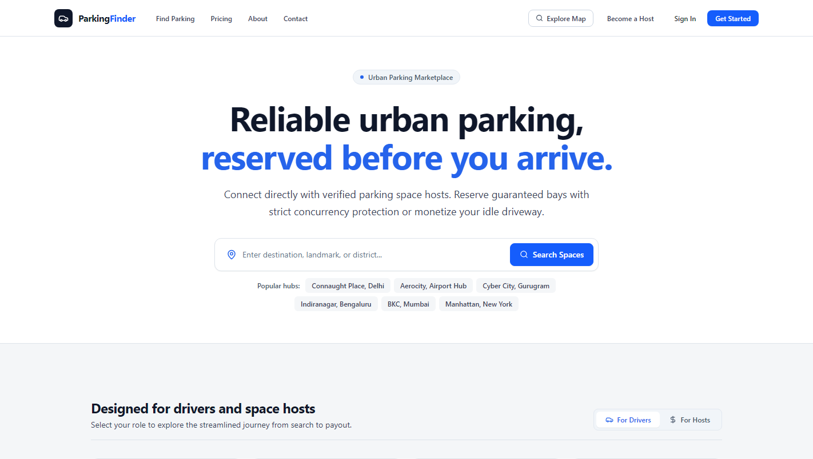
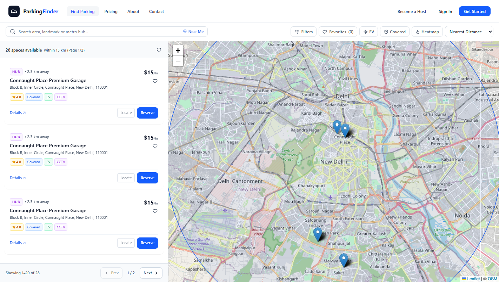
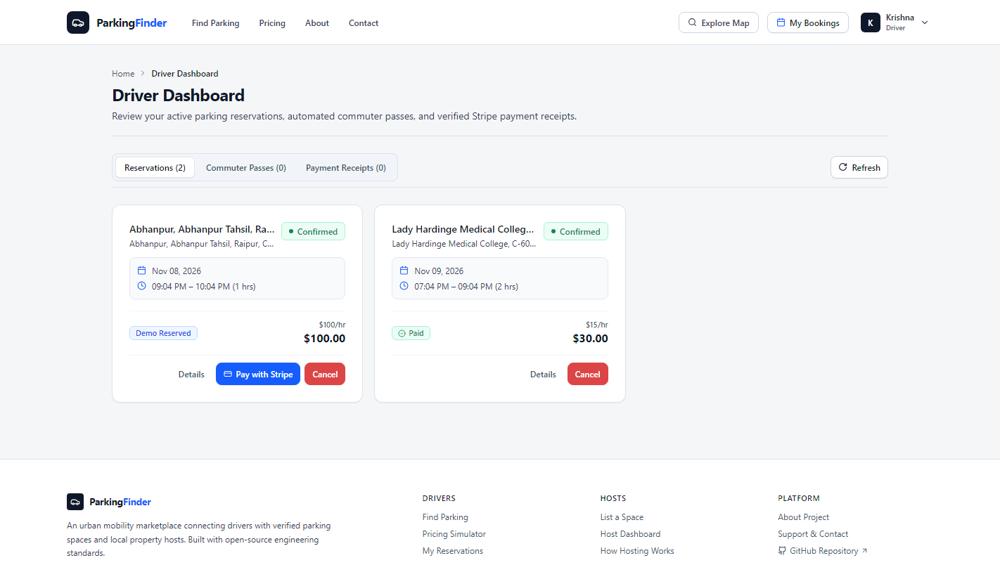
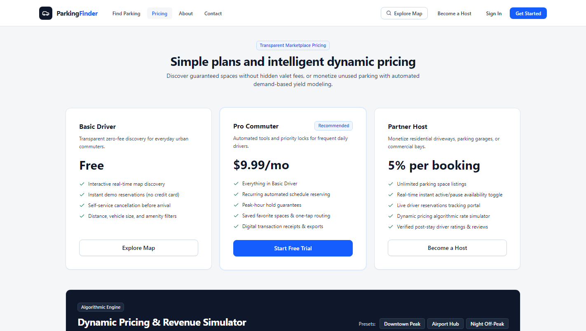
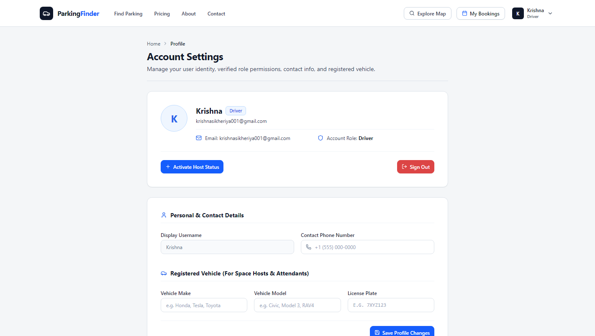
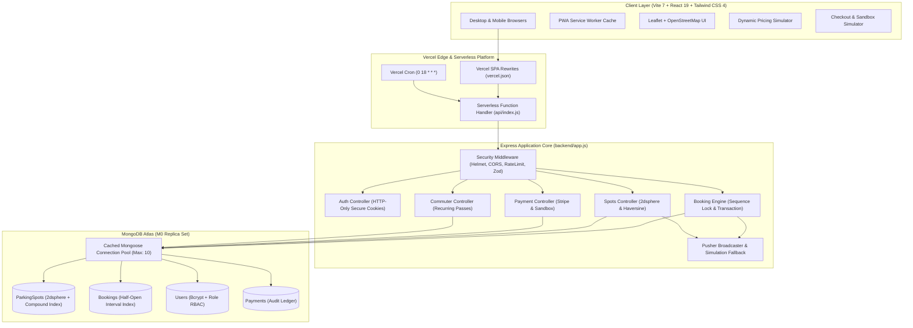

<div align="center">


# ParkingFinder 2.0

A two-sided parking marketplace connecting drivers with urban hosts, featuring atomic slot reservation, geospatial discovery, dynamic pricing simulation, and real-time availability updates.

[Live Demo](https://parkingfinder-three.vercel.app) · [Interactive API Docs](https://parkingfinder-three.vercel.app/api-docs) · [Architecture Guide](docs/ARCHITECTURE.md) · [Bug Report](https://github.com/Krishna200608/ParkingFinder/issues)

[](https://github.com/Krishna200608/ParkingFinder/actions)
[](LICENSE)
[](https://parkingfinder-three.vercel.app)
[](https://nodejs.org)
[](https://react.dev)

</div>

---

## Highlights

* **Atomic Slot Reservation:** Guarantees zero double-bookings via MongoDB document write-locks (`$inc: { bookingSequence: 1 }`) within multi-document transaction sessions and exponential backoff retry logic.
* **Geospatial Discovery:** Queries parking inventory by spherical distance using GeoJSON `2dsphere` indexes with OpenStreetMap Nominatim geocoding and Haversine distance calculations.
* **Dynamic Pricing Simulation:** Interactive client-side model demonstrating time-of-day surge, occupancy density elasticity, and amenity premiums with 24-hour yield curve visualization.
* **Real-Time Availability Sync:** Broadcasts slot reservations and cancellations instantly across clients via Pusher Channels, with automatic fallback to in-memory simulation when API keys are absent.
* **Automated Commuter Renewals:** Daily Vercel Cron trigger creates recurring weekday reservations at an automated 15% discount, verifying half-open interval availability prior to commit.

---

## Screenshots and Previews

| Homepage and Search | Geospatial Discovery Map |
| :---: | :---: |
| <br><sub>Landing page with metro search presets and dynamic pricing simulator link</sub> | <br><sub>Interactive Leaflet map with radius filtering and spot details</sub> |

| Driver and Host Dashboard | Dynamic Pricing Simulator |
| :---: | :---: |
| <br><sub>Unified dashboard for reservation management, payments, and commuter passes</sub> | <br><sub>Algorithmic pricing tiers and dynamic revenue simulation model</sub> |

| User Account Settings |
| :---: |
| <br><sub>User profile with role switching between driver and host</sub> |

* [Watch the Driver Walkthrough (MP4)](screenshots/Driver_small.mp4)
* [Watch the Host Walkthrough (MP4)](screenshots/host_small.mp4)

---

## Table of Contents

- [System Architecture](#system-architecture)
- [Key Engineering Differentiators](#key-engineering-differentiators)
- [Automated Test Coverage](#automated-test-coverage)
- [Technology Stack](#technology-stack)
- [Documentation](#documentation)
- [REST API Reference](#rest-api-reference)
- [Getting Started](#getting-started)
- [Known Limitations and Roadmap](#known-limitations-and-roadmap)
- [License](#license)

---

## System Architecture



---

## Key Engineering Differentiators

### 1. Concurrency-Safe Booking Engine
* **What it does:** Prevents duplicate bookings when two drivers attempt to reserve the same spot for overlapping time intervals simultaneously.
* **Mechanism:** Executes inside a MongoDB multi-document transaction session via `executeWithRetry` in [`backend/controllers/bookings.controller.js`](backend/controllers/bookings.controller.js). It atomically increments `bookingSequence` on the spot document to acquire an exclusive write lock, serializing concurrent requests before checking interval availability. Colliding requests return `HTTP 409 Conflict`.
* **Details:** See [Architecture Guide: Concurrency Control](docs/ARCHITECTURE.md#concurrency-safe-booking-engine).

### 2. Strict Half-Open Interval Collision Logic
* **What it does:** Allows back-to-back bookings (e.g., 10:00–12:00 and 12:00–14:00) without false-positive overlap rejections while rejecting overlapping times.
* **Mechanism:** Evaluates temporal intervals over $[StartTime, EndTime)$ using the condition `existing.startTime < requested.endTime && existing.endTime > requested.startTime` in [`backend/controllers/bookings.controller.js`](backend/controllers/bookings.controller.js). Contiguous minute boundaries evaluate to false, maximizing bay occupancy.

### 3. Dynamic Algorithmic Pricing Simulator
* **What it does:** Simulates hourly parking rates dynamically based on demand elasticity, time-of-day surge, and space amenities.
* **Mechanism:** Implemented client-side in [`frontend/src/pages/PricingPage.jsx`](frontend/src/pages/PricingPage.jsx) and typed via [`frontend/src/utils/pricingCalculator.ts`](frontend/src/utils/pricingCalculator.ts). Applies the formula:
  $$P_{\text{simulated}} = P_{\text{base}} \times \left(1 + \alpha \cdot D + \beta \cdot T_{\text{surge}} + \gamma \cdot E_{\text{premium}}\right)$$
  with bounded safety guardrails enforcing minimum yield ($1.00/hr) and anti-gouging caps ($3 \times P_{\text{base}}$).

### 4. Geospatial Proximity Discovery
* **What it does:** Resolves parking spots within a defined radial distance of a user's location or searched landmark.
* **Mechanism:** Queries GeoJSON coordinates using a native `2dsphere` index via `$near` in [`backend/models/parkingSpot.model.js`](backend/models/parkingSpot.model.js) and computes spherical Haversine distances in [`backend/controllers/spots.controller.js`](backend/controllers/spots.controller.js) with 450 ms debounced OpenStreetMap Nominatim geocoding.

### 5. Dual-Mode Payment Architecture
* **What it does:** Supports both real Stripe Checkout and a self-contained local Sandbox Simulator without third-party credentials.
* **Mechanism:** [`backend/controllers/payments.controller.js`](backend/controllers/payments.controller.js) inspects `STRIPE_SECRET_KEY`. When absent, it defaults to sandbox mode (`/checkout-simulator`), recording payments to an audit ledger. When keys are present, it initializes Stripe Checkout Sessions with dynamic payment methods and verifies cryptographic webhook signatures (`POST /api/payments/webhook`).

### 6. Verified Review Gating
* **What it does:** Prevents fraudulent ratings and spam reviews on host listings.
* **Mechanism:** The review submission handler in [`backend/controllers/spots.controller.js`](backend/controllers/spots.controller.js) verifies that the reviewing driver has a completed or active booking for that specific spot before allowing insertion, returning `HTTP 403 Forbidden` otherwise.

### 7. Serverless Connection Pooling and Bundling
* **What it does:** Prevents database connection exhaustion across serverless function instances and maintains fast page loads.
* **Mechanism:** Reuses a global cached Mongoose connection (`maxPoolSize: 10`) across Vercel invocations in [`backend/db.js`](backend/db.js) and uses manual Rollup chunk splitting in [`frontend/vite.config.js`](frontend/vite.config.js) to keep vendor bundles compact.

### 8. Admin Governance and Platform Analytics
* **What it does:** Provides administrators with real-time platform financial metrics and moderation tools.
* **Mechanism:** Aggregation pipelines in [`backend/controllers/admin.controller.js`](backend/controllers/admin.controller.js) compute Gross Merchandise Value (GMV), 5% platform take-rate revenue, and host liabilities. Endpoints enforce role checks via `isAdmin` middleware with self-demotion lockout safeguards.

### 9. Recurring Commuter Pass and Cron Engine
* **What it does:** Automatically books weekday reservations for recurring commuters at an automated 15% discount.
* **Mechanism:** A Vercel Cron trigger executes `GET /api/cron/commuter-passes` daily at 18:00 UTC ([`vercel.json`](vercel.json)), invoking [`backend/controllers/commuter.controller.js`](backend/controllers/commuter.controller.js) to evaluate active passes, verify interval availability, and commit bookings for the next commute day.

### 10. Real-Time Live Availability Engine
* **What it does:** Updates driver browser views instantaneously when a spot is booked or released without manual page refreshes.
* **Mechanism:** REST triggers in [`backend/utils/pusher.js`](backend/utils/pusher.js) broadcast events over Pusher Channels to [`frontend/src/hooks/useRealtimeSpot.js`](frontend/src/hooks/useRealtimeSpot.js). When Pusher keys are omitted, the module gracefully falls back to structured in-memory logging, enabling local development and testing with zero external services.

---

## Automated Test Coverage

The test suite runs with Vitest against a live MongoDB replica set, verifying 69 test cases across 8 test suites:

| Test Suite | Scope Covered | Tests |
| :--- | :--- | :---: |
| [`test/booking.test.js`](test/booking.test.js) | Atomic concurrency write locks, race conditions, half-open collisions, cancellations | 10 |
| [`test/discovery.test.js`](test/discovery.test.js) | 2dsphere geo queries, distance sorting, amenity filters, verified review prerequisites | 11 |
| [`test/admin.test.js`](test/admin.test.js) | Executive metrics, GMV take rate, user management, spot moderation, lockout guards | 12 |
| [`test/commuter.test.js`](test/commuter.test.js) | 15% commuter discount, pause/resume, Vercel cron renewals, collision skips | 11 |
| [`test/payment.test.js`](test/payment.test.js) | Stripe checkout sessions, sandbox test mode, immutable ledger, webhook processing | 9 |
| [`test/realtime.test.js`](test/realtime.test.js) | Pusher channel triggers, live sync events, credential-less simulation fallback | 6 |
| [`test/host.test.js`](test/host.test.js) | Host spot listings, earnings aggregation, active booking deletion safeguards | 5 |
| [`test/observability.test.js`](test/observability.test.js) | Sentry lazy-init, unhandled exception capture, health check diagnostics | 5 |
| **Total** | **Full-stack unit, integration, concurrency, and RBAC verification** | **69** |

---

## Technology Stack

| Layer | Technology | Purpose |
| :--- | :--- | :--- |
| **Frontend** | React 19, Vite 7, Tailwind CSS 4 | Single-page application client and styling |
| **Mapping** | Leaflet, React-Leaflet, OpenStreetMap | Interactive geospatial discovery and radius rendering |
| **Real-Time** | Pusher Channels, Pusher-js | WebSocket event broadcasting and UI revalidation |
| **Observability** | Sentry (Node.js & React SDKs) | Exception monitoring and performance tracing |
| **Backend** | Node.js (v22 LTS), Express 4.x | REST API routing and middleware pipeline |
| **Database** | MongoDB Atlas (M0 Replica Set), Mongoose 8 | Document storage with 2dsphere indexes and transactions |
| **Validation** | Zod | Runtime schema validation for requests and environment |
| **Security** | Helmet, CORS, Express-Rate-Limit, Bcrypt | HTTP security headers, rate limiting, and password hashing |
| **Payments** | Stripe API, Local Sandbox Simulator | Dual-mode checkout sessions and webhook handling |
| **Testing** | Vitest, Supertest | Unit, integration, and concurrent race-condition testing |
| **Hosting & CI** | Vercel Serverless, GitHub Actions | Zero-cost serverless deployment, Vercel Cron, and CI/CD |

---

## Documentation

* [Architecture Guide](docs/ARCHITECTURE.md): Detailed subsystem breakdowns, data models, and sequence flows.
* [Architectural Decision Records (ADRs)](docs/DECISIONS.md): Context and trade-offs for technical decisions.
* [Deployment Guide](docs/DEPLOYMENT.md): Step-by-step instructions for deploying to Vercel and MongoDB Atlas.
* [Project Roadmap](docs/ROADMAP.md): Tracked features, milestones, and future platform capabilities.
* [Security Audit Report](docs/audits/SECURITY_AUDIT.md): Vulnerability assessments, remediations, and hardening steps.

---

## REST API Reference

Interactive OpenAPI 3.0 documentation is available at `/api-docs` (Swagger UI) when the server is running, with raw JSON exported at `/api/docs.json`.

<details>
<summary><strong>Click to view complete REST API endpoint summary (35 routes)</strong></summary>

<br>

### Authentication (`/api/auth`)
| Method | Route | Access | Description |
| :--- | :--- | :--- | :--- |
| `POST` | `/api/auth/register` | Public | Register user (`driver` or `host`) |
| `POST` | `/api/auth/login` | Public | Authenticate credentials and set HTTP-only JWT cookie |
| `POST` | `/api/auth/logout` | Public | Clear auth cookie |
| `GET` | `/api/auth/me` | Authenticated | Return current user profile |

### Parking Spaces (`/api/spots`)
| Method | Route | Access | Description |
| :--- | :--- | :--- | :--- |
| `GET` | `/api/spots` | Public | Geospatial discovery with filters (`lat`, `lng`, `radius`, `amenities`) |
| `GET` | `/api/spots/demand-heatmap` | Public | Regional demand density coordinates |
| `POST` | `/api/spots/seed` | Admin in Prod / Dev | Seed default metro spots (gated behind Admin in production) |
| `GET` | `/api/spots/my` | Host Only | Return host's listings with aggregated earnings |
| `GET` | `/api/spots/:id` | Public | Return spot details, host info, and verified reviews |
| `POST` | `/api/spots` | Host Only | Create listing with coordinates and amenities |
| `PUT` | `/api/spots/:id` | Owner | Update listing details or toggle availability |
| `DELETE` | `/api/spots/:id` | Owner | Delete spot (guarded against active bookings) |
| `POST` | `/api/spots/:id/reviews` | Verified Driver | Submit review (requires completed booking) |

### Reservations (`/api/bookings`)
| Method | Route | Access | Description |
| :--- | :--- | :--- | :--- |
| `POST` | `/api/bookings` | Driver Only | Create booking with concurrency lock and price snapshot |
| `GET` | `/api/bookings/me` | Driver Only | Return driver booking history |
| `GET` | `/api/bookings/host` | Host Only | Return incoming reservations for host spots |
| `GET` | `/api/bookings/spot/:spotId/availability` | Public | Calculate occupied and free slots for a date |
| `GET` | `/api/bookings/:id` | Participant | Return single booking details with audit trail |
| `PUT` | `/api/bookings/:id/cancel` | Owner | Cancel reservation with audit metadata |

### Payments (`/api/payments`)
| Method | Route | Access | Description |
| :--- | :--- | :--- | :--- |
| `POST` | `/api/payments/create-checkout-session` | Driver Only | Initialize Stripe Checkout or Sandbox Simulator link |
| `GET` | `/api/payments/verify-session` | Driver Only | Confirm payment status with Stripe / Simulator |
| `POST` | `/api/payments/simulate-success` | Driver Only | Authorize test card payment in Sandbox mode |
| `POST` | `/api/payments/webhook` | Public | Stripe webhook listener with cryptographic signature check |
| `GET` | `/api/payments/my-transactions` | Driver Only | Return driver transaction history and receipts |

### Platform Administration (`/api/admin`)
| Method | Route | Access | Description |
| :--- | :--- | :--- | :--- |
| `GET` | `/api/admin/metrics` | Admin Only | Platform GMV, 5% take-rate revenue, and active bays |
| `GET` | `/api/admin/users` | Admin Only | Paginated user directory with role and query filters |
| `PUT` | `/api/admin/users/:id/role` | Admin Only | Update user role with self-demotion lockout safeguards |
| `GET` | `/api/admin/spots` | Admin Only | Global spot directory across all hosts |
| `PUT` | `/api/admin/spots/:id/status` | Admin Only | Moderation toggle to suspend or activate listing |
| `GET` | `/api/admin/bookings` | Admin Only | Global booking audit log across all marketplace users |

### Commuter Passes (`/api/commuter`)
| Method | Route | Access | Description |
| :--- | :--- | :--- | :--- |
| `POST` | `/api/commuter` | Driver Only | Activate recurring weekday pass with 15% discount |
| `GET` | `/api/commuter/my` | Driver Only | List driver's active and paused subscriptions |
| `PUT` | `/api/commuter/:id/toggle` | Pass Owner | Pause or resume recurring commuter pass |
| `DELETE` | `/api/commuter/:id` | Pass Owner | Cancel commuter subscription |
| `GET` | `/api/cron/commuter-passes` | Cron / Admin | Scheduled cron execution (18:00 UTC daily) |
| `POST` | `/api/commuter/process-cron` | Cron / Admin | On-demand trigger for commuter scheduler |

</details>

---

## Getting Started

### 1. Prerequisites
* **Node.js:** v20.x or v22.x LTS
* **Package Manager:** npm v10+
* **MongoDB:** MongoDB Atlas free M0 cluster or a local MongoDB replica set.
  > *Note on MongoDB Transactions:* Multi-document booking transactions require a replica set. When running locally with Docker:
  > ```bash
  > docker run -d --name mongodb -p 27017:27017 mongo:7.0 mongod --replSet rs0 --bind_ip_all
  > docker exec mongodb mongosh --eval "rs.initiate({ _id: 'rs0', members: [{ _id: 0, host: '127.0.0.1:27017' }] })"
  > ```

### 2. Clone and Install
```bash
git clone https://github.com/Krishna200608/ParkingFinder.git
cd ParkingFinder
npm install
```

### 3. Environment Configuration
Copy the provided environment templates and configure your values:

```bash
cp backend/.env.example backend/.env
cp frontend/.env.example frontend/.env
```

| Variable | Location | Required | Purpose |
| :--- | :--- | :---: | :--- |
| `PORT` | `backend/.env` | No | Server port (defaults to `5001`) |
| `MONGO_URI` | `backend/.env` | **Yes** | MongoDB replica set connection string |
| `JWT_SECRET` | `backend/.env` | **Yes** | Secret for signing session tokens |
| `NODE_ENV` | `backend/.env` | No | `development`, `production`, or `test` |
| `CLIENT_URL` | `backend/.env` | No | Frontend client origin (default: `http://localhost:3000`) |
| `STRIPE_SECRET_KEY` | `backend/.env` | No | Activates real Stripe Checkout; defaults to Sandbox Simulator if omitted |
| `STRIPE_WEBHOOK_SECRET` | `backend/.env` | No | For verifying live Stripe webhook signatures |
| `PUSHER_APP_ID`, `PUSHER_KEY`, `PUSHER_SECRET` | `backend/.env` | No | Real-time WebSocket broadcasting; defaults to in-memory simulation if omitted |
| `VITE_PUSHER_KEY`, `VITE_PUSHER_CLUSTER` | `frontend/.env` | No | Client-side Pusher subscription credentials |
| `SENTRY_DSN`, `VITE_SENTRY_DSN` | Both | No | Exception monitoring (disabled when omitted) |
| `CRON_SECRET` | `backend/.env` | No | Secures Vercel Cron endpoints in production |

### 4. Run Development Servers
```bash
# Terminal 1: Start Backend API (Port 5001)
npm run start --prefix backend

# Terminal 2: Start Frontend Client (Port 3000)
npm run start --prefix frontend
```
Navigate to `http://localhost:3000` in your browser.

### 5. Automated Tests and Verification
```bash
# Run the complete test suite (69 tests across 8 suites)
npm test

# Run ESLint across the codebase
npm run lint

# Validate the production Vite bundle
npm run build
```

---

## Known Limitations and Roadmap

1. **Standalone MongoDB Transactions:** Multi-document booking transactions require a replica set. Standalone MongoDB instances fall back to non-transactional execution.
2. **Nominatim Geocoding Rate Limits:** Address search relies on OpenStreetMap Nominatim with public rate limits (1 req/sec). High-concurrency production requires a dedicated geocoding provider (e.g. Mapbox or Google Places).
3. **Pusher Free Tier Ceiling:** The real-time live availability engine operates on Pusher Channels free tier (200,000 messages/day, 100 concurrent connections). Scaling beyond this requires an upgraded plan or self-hosted Soketi instance.
4. **Cloudinary Presets:** Spot photo uploads currently use client-side unsigned Cloudinary presets. Migration to presigned direct-to-S3/R2 uploads is planned in a future release.

---

## License

This project is licensed under the [MIT License](LICENSE).
