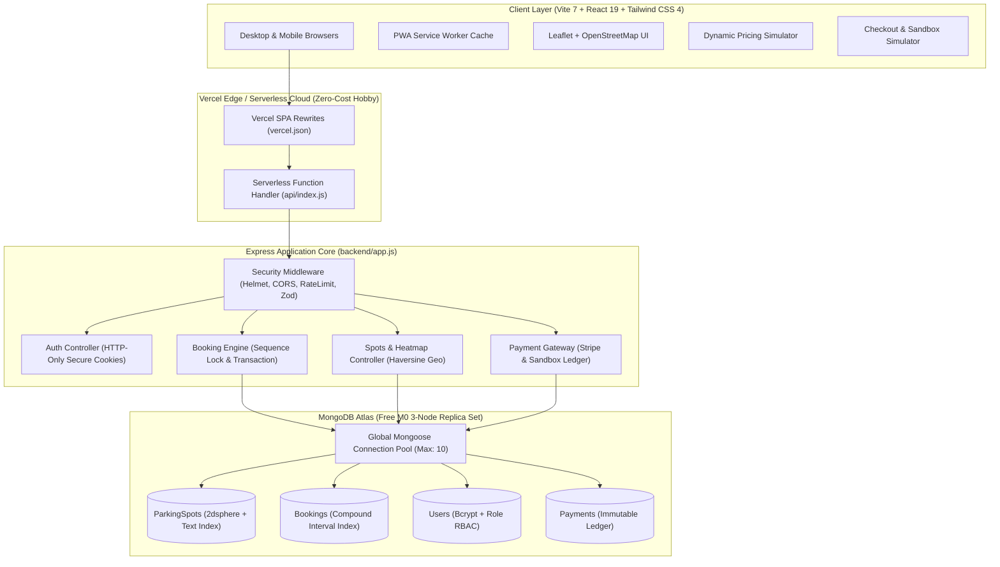

# ParkingFinder 2.0 — Smart Urban Parking Marketplace

[](https://github.com/Krishna200608/ParkingFinder/actions)
[](./test)
[](LICENSE)
[](https://vercel.com)
[](./frontend/public/manifest.json)
[](./frontend)

> A production-grade, two-sided parking marketplace connecting drivers with urban hosts and commercial operators. Engineered with concurrency-safe booking locks, geospatial 2dsphere discovery, OpenStreetMap Nominatim geocoding, algorithmic dynamic pricing, dual-mode payment reconciliation, and zero-cost serverless deployment on Vercel and MongoDB Atlas.

---

## Table of Contents

- [System Architecture](#system-architecture)
- [Key Engineering Differentiators](#key-engineering-differentiators)
  - [1. Concurrency-Safe Booking Engine](#1-concurrency-safe-booking-engine)
  - [2. Strict Half-Open Interval Collision Logic](#2-strict-half-open-interval-collision-logic)
  - [3. Dynamic Algorithmic Pricing Simulator](#3-dynamic-algorithmic-pricing-simulator)
  - [4. Geospatial Discovery and Demand Heatmap](#4-geospatial-discovery-and-demand-heatmap)
  - [5. Payment Gateway Reconciliation and Sandbox Simulation](#5-payment-gateway-reconciliation-and-sandbox-simulation)
  - [6. Verified Marketplace Reviews](#6-verified-marketplace-reviews)
  - [7. Zero-Cost Serverless Infrastructure](#7-zero-cost-serverless-infrastructure)
  - [8. Admin Governance & Platform Analytics](#8-admin-governance--platform-analytics)
  - [9. Recurring Commuter Pass & Vercel Cron Engine](#9-recurring-commuter-pass--vercel-cron-engine)
- [Automated Test Coverage](#automated-test-coverage)
- [Technology Stack](#technology-stack)
- [REST API Reference](#rest-api-reference)
  - [Authentication (`/api/auth`)](#authentication-apiauth)
  - [Parking Spaces and Discovery (`/api/spots`)](#parking-spaces-and-discovery-apispots)
  - [Reservations and Bookings (`/api/bookings`)](#reservations-and-bookings-apibookings)
  - [Payments and Checkout (`/api/payments`)](#payments-and-checkout-apipayments)
  - [Platform Governance & Administration (`/api/admin`)](#platform-governance--administration-apiadmin)
  - [Recurring Commuter Subscriptions (`/api/commuter`)](#recurring-commuter-subscriptions-apicommuter)
- [Getting Started](#getting-started)
  - [1. Prerequisites](#1-prerequisites)
  - [2. Clone and Install](#2-clone-and-install)
  - [3. Environment Variables](#3-environment-variables)
  - [4. Run Development Servers](#4-run-development-servers)
  - [5. Automated Tests and Verification](#5-automated-tests-and-verification)
- [Deployment](#deployment)
- [Security and Reliability](#security-and-reliability)
- [License](#license)

---

## System Architecture



---

## Key Engineering Differentiators

### 1. Concurrency-Safe Booking Engine
* **The Problem:** In standard reservation platforms, two simultaneous booking requests can execute availability checks concurrently against uncommitted database state, leading to duplicate bookings of the same physical parking spot.
* **The Engineering Solution:** Implemented transactional execution with document-level serialization in `backend/controllers/bookings.controller.js`. The engine acquires an atomic write lock via `$inc: { bookingSequence: 1 }` on the parking spot within a MongoDB multi-document transaction session. Bounded exponential backoff retries (`executeWithRetry`) handle write conflicts gracefully.
* **Concurrency Validation:** An automated race-condition test in `test/booking.test.js` fires simultaneous overlapping booking requests against the database and asserts that strictly one request succeeds while colliding requests receive `HTTP 409 Conflict`.

### 2. Strict Half-Open Interval Collision Logic
* Interval overlap is defined strictly over the half-open temporal interval $[StartTime, EndTime)$:
  $$\text{Overlap} \iff \text{ExistingStart} < \text{RequestedEnd} \land \text{ExistingEnd} > \text{RequestedStart}$$
* Contiguous reservations (e.g., 10:00–12:00 and 12:00–14:00) share exact minute boundaries without generating false-positive collisions, maximizing bay utilization for hosts.

### 3. Dynamic Algorithmic Pricing Simulator
* Implemented real-time dynamic pricing model in `frontend/src/pages/PricingPage.jsx` and backend rate calculations:
  $$P_{\text{simulated}} = P_{\text{base}} \times \left(1 + \alpha \cdot D + \beta \cdot T_{\text{surge}} + \gamma \cdot E_{\text{premium}}\right)$$
* **Parameters:** Base rate $P_{\text{base}}$, neighborhood occupancy density $D \in [0, 1]$, demand elasticity $\alpha$, time-of-day surge factor $\beta$ (Night $-25\%$, Morning Peak $+35\%$, Midday $+5\%$, Evening Rush $+40\%$), and amenity premiums $\gamma$ (EV Supercharging $+15\%$, Covered Bay $+10\%$).
* **Guardrails:** Algorithmic clamps enforce safety bounds preventing price gouging ($P_{\text{simulated}} \le 3 \cdot P_{\text{base}}$) and protect host yield with a strict floor ($P_{\text{simulated}} \ge \$1.00/\text{hr}$).

### 4. Geospatial Discovery and Demand Heatmap
* **Geocoding:** Integrated address and landmark search powered by OpenStreetMap Nominatim with 450ms input debouncing and compliant User-Agent headers.
* **Haversine Distance:** Dynamically calculated on the server and attached to every spot response for accurate spatial sorting and radius filtering.
* **Heatmap Overlay:** The `GET /api/spots/demand-heatmap` endpoint aggregates regional occupancy, producing location-weighted demand scores rendered as dynamic radial circles on Leaflet.

### 5. Payment Gateway Reconciliation and Sandbox Simulation
* **Dual-Mode Billing:** Supports both live Stripe Checkout Sessions and a self-contained local Sandbox Simulator (`/checkout-simulator`) requiring no third-party keys for local verification.
* **Cryptographic HMAC Webhooks:** Secure webhook listener (`POST /api/payments/webhook`) validates signatures before updating reservation status to `paid`.
* **Immutable Payment Ledger:** Payments write non-destructively to a dedicated collection, providing an audit trail accessible via `GET /api/payments/my-transactions`.

### 6. Verified Marketplace Reviews
* Drivers can submit ratings and reviews only after completing a verified booking for that specific spot.
* Unverified review submissions are blocked at the controller layer with `HTTP 403 Forbidden`.

### 7. Zero-Cost Serverless Infrastructure
* Clean separation of concerns across `backend/app.js` (Express application), `backend/server.js` (local development server), and `api/index.js` (Vercel serverless entry point).
* Global Mongoose connection caching (`global.mongoose = { conn, promise }`) with `maxPoolSize: 10` conserves MongoDB Atlas free-tier connection pools across serverless function invocations.
* Vite manual chunking separates vendor dependencies, Leaflet mapping assets, and UI components to maintain fast cold-start performance and minimal bundle footprints.

### 8. Admin Governance & Platform Analytics
* **Executive Metrics Aggregation:** Computes live marketplace health, Gross Merchandise Value (GMV), 5% platform take-rate revenue, host liabilities (95%), active bay inventory, and reservation utilization via parallel MongoDB aggregation pipelines.
* **Spot Moderation:** Administrative controls to suspend or activate listings across all hosts to enforce content safety and neighborhood compliance.
* **Role-Based Access Control (RBAC):** Privileged endpoints protected by layered `protect` and `isAdmin` middleware, preventing unauthorized access and safeguarding against administrator self-demotion lockout.
* **Audit Trails:** Real-time visibility into the latest 10 ledger transactions and global platform bookings.

### 9. Recurring Commuter Pass & Vercel Cron Engine
* **Automated Renewal Scheduler:** Vercel Cron scheduled endpoint (`GET /api/cron/commuter-passes`) evaluates active commuter passes daily at 18:00 UTC, creating confirmed reservations for tomorrow's scheduled commute.
* **Commuter Discount Pricing:** Applies an automated 15% discount across daily rates for drivers committing to recurring weekday intervals (e.g. Monday–Friday 09:00–17:00).
* **Collision Resolution & Failure Handling:** Prior to committing automated renewals, runs half-open interval overlap checks against existing bookings; if a collision occurs, increments conflict counts, alerts the user, and skips duplicate bookings gracefully.

---

## Automated Test Coverage

The project includes 58 automated unit and integration tests across 6 comprehensive test suites executed via Vitest against a live MongoDB replica set:

| Test Suite | Scenarios Verified | Passing |
| :--- | :--- | :--- |
| `test/booking.test.js` | Normal booking creation, price snapshots, demo statuses, overlap collision rejection (`HTTP 409`), contiguous abutting reservations, past-time rejection, host self-booking prevention, cancellation audit trail, unauthorized cancellation rejection, and **simultaneous race condition concurrency locking**. | **10 / 10** |
| `test/discovery.test.js` | Public spot retrieval without auth cookies, geospatial radius filtering, Haversine `distanceKm` computation, `maxPrice`, `amenities`, `vehicleSize`, text keyword search, sort ordering, spot details by ID, verified driver review gating, and pagination envelopes. | **11 / 11** |
| `test/host.test.js` | Host listings with aggregated earnings from `GET /api/spots/my`, instant availability toggle via `PUT /api/spots/:id`, incoming driver reservations table, active booking deletion guard (`HTTP 400`), and clean listing deletion. | **5 / 5** |
| `test/payment.test.js` | Stripe checkout session creation, sandbox test-mode payment authorization, immutable Payment ledger writes, session status verification, cryptographic webhook simulation, and driver transaction history retrieval. | **9 / 9** |
| `test/admin.test.js` | RBAC middleware gating (401/403 rejection), aggregate platform metrics and economics, paginated user directory with search, role reassignment, self-demotion lockout prevention, spot listing suspension/activation moderation, and global booking audit trail. | **12 / 12** |
| `test/commuter.test.js` | Commuter pass creation, 15% discount calculations, self-subscription prevention, unauthenticated rejection, pass list retrieval, pause/resume state toggling, unauthorized modification guards (403), scheduled cron renewal execution, redundant booking skipping, collision detection, and subscription cancellation. | **11 / 11** |
| **Total** | **End-to-end full-stack verification across all core marketplace, administrative, and scheduler workflows** | **58 / 58 Passing** |

---

## Technology Stack

| Layer | Technology | Version | Purpose |
| :--- | :--- | :--- | :--- |
| **Frontend Framework** | React | 19.x | Modern component-based user interface |
| **Build Tooling** | Vite | 7.x | Rapid compilation, HMR, and manual chunk bundling |
| **Styling** | Tailwind CSS | 4.x | Utility-first responsive design system |
| **Animation** | Framer Motion | 12.x | Hardware-accelerated UI transitions and modal animations |
| **Mapping** | Leaflet & React-Leaflet | 1.9.x | OpenStreetMap geospatial rendering and interactive markers |
| **Geocoding** | Nominatim API | v2 | Debounced location and address search |
| **Backend Runtime** | Node.js | 20+ / 22 LTS | High-performance asynchronous JavaScript runtime |
| **Web Framework** | Express.js | 4.x | REST API routing and middleware composition |
| **Database** | MongoDB Atlas | Free M0 | Cloud document database with 2dsphere indexing and replica set transactions |
| **ODM** | Mongoose | 8.x | Strict schema definitions and connection pooling |
| **Validation** | Zod | 3.x | Runtime request body schema validation |
| **Security** | Helmet & CORS | Latest | Security headers and cross-origin resource policy enforcement |
| **Authentication** | JWT & HTTP-Only Cookies | Latest | Secure, stateless, CSRF-resistant session tokens |
| **Payments** | Stripe & Sandbox | Latest | Dual-mode checkout sessions and simulated transactions |
| **Testing** | Vitest & Supertest | 3.x / 7.x | Full-stack unit, integration, and concurrency testing |
| **Deployment** | Vercel Serverless | Latest | Zero-cost serverless hosting with SPA routing |
| **CI / CD** | GitHub Actions | Ubuntu Latest | Automated testing, linting, and build verification |

---

## REST API Reference

### Authentication (`/api/auth`)
| Method | Route | Access | Description |
| :--- | :--- | :--- | :--- |
| `POST` | `/api/auth/register` | Public | Register new user. Zod schema restricts role to `driver` or `host`. |
| `POST` | `/api/auth/login` | Public | Authenticates credentials and sets secure HTTP-only JWT cookie. |
| `POST` | `/api/auth/logout` | Public | Clears JWT cookie and terminates session. |
| `GET` | `/api/auth/me` | Authenticated | Returns current authenticated user profile. |

### Parking Spaces and Discovery (`/api/spots`)
| Method | Route | Access | Description |
| :--- | :--- | :--- | :--- |
| `GET` | `/api/spots` | Public | Discover spots with multi-filters (`lat`, `lng`, `radius`, `maxPrice`, `amenities`, `vehicleSize`, `search`, `sort`). |
| `GET` | `/api/spots/demand-heatmap` | Public | Returns parking demand density heatmap coordinates. |
| `POST` | `/api/spots/seed` | Public | Seeds realistic demo spots across metro locations idempotently. |
| `GET` | `/api/spots/my` | Host Only | Returns host's listings with aggregated earnings and booking counts. |
| `GET` | `/api/spots/:id` | Public | Returns spot details, host info, amenities, and verified reviews. |
| `POST` | `/api/spots` | Host Only | Create new parking space listing with coordinates and amenities. |
| `PUT` | `/api/spots/:id` | Listing Owner | Update spot details or toggle `isAvailable` status. |
| `DELETE` | `/api/spots/:id` | Listing Owner | Delete spot (guarded against deletion if active bookings exist). |
| `POST` | `/api/spots/:id/reviews` | Verified Driver | Submit review (requires completed or active booking). |

### Reservations and Bookings (`/api/bookings`)
| Method | Route | Access | Description |
| :--- | :--- | :--- | :--- |
| `POST` | `/api/bookings` | Driver Only | Create reservation with concurrency write locks and price snapshot. |
| `GET` | `/api/bookings/me` | Driver Only | Returns driver booking history and active reservations. |
| `GET` | `/api/bookings/host` | Host Only | Returns incoming driver reservations for host parking spaces. |
| `GET` | `/api/bookings/spot/:spotId/availability` | Public | Computes occupied intervals and free contiguous slots for a given date. |
| `GET` | `/api/bookings/:id` | Participant | Returns single booking details with audit trail. |
| `PUT` | `/api/bookings/:id/cancel` | Booking Owner | Cancels booking with audit trail (`cancelledAt`, `cancelledBy`, `reason`). |

### Payments and Checkout (`/api/payments`)
| Method | Route | Access | Description |
| :--- | :--- | :--- | :--- |
| `POST` | `/api/payments/create-checkout-session` | Driver Only | Creates Stripe Checkout Session or returns Sandbox Simulator link. |
| `GET` | `/api/payments/verify-session` | Driver Only | Verifies session status with Stripe / Simulator and updates booking. |
| `POST` | `/api/payments/simulate-success` | Driver Only | Authorizes simulated test card payment in Sandbox mode. |
| `POST` | `/api/payments/webhook` | Public | Stripe webhook listener with cryptographic HMAC signature verification. |
| `GET` | `/api/payments/my-transactions` | Driver Only | Retrieves driver verified payment ledger and receipts. |

### Platform Governance & Administration (`/api/admin`)
| Method | Route | Access | Description |
| :--- | :--- | :--- | :--- |
| `GET` | `/api/admin/metrics` | Admin Only | Aggregate platform analytics, GMV, platform take (5%), and host liabilities. |
| `GET` | `/api/admin/users` | Admin Only | Paginated user directory with role and search queries. |
| `PUT` | `/api/admin/users/:id/role` | Admin Only | Update user role with self-demotion lockout safeguards. |
| `GET` | `/api/admin/spots` | Admin Only | Global spot directory across all hosts with status filters. |
| `PUT` | `/api/admin/spots/:id/status` | Admin Only | Moderation toggle to suspend or activate listing availability. |
| `GET` | `/api/admin/bookings` | Admin Only | Global booking audit trail with driver, host, and spot details. |

### Recurring Commuter Subscriptions (`/api/commuter`)
| Method | Route | Access | Description |
| :--- | :--- | :--- | :--- |
| `POST` | `/api/commuter` | Driver Only | Activate recurring weekday commuter pass with 15% discount. |
| `GET` | `/api/commuter/my` | Driver Only | Retrieve active and paused commuter subscriptions. |
| `PUT` | `/api/commuter/:id/toggle` | Pass Owner | Pause or resume recurring commuter pass. |
| `DELETE` | `/api/commuter/:id` | Pass Owner | Cancel commuter pass subscription. |
| `GET` | `/api/cron/commuter-passes` | Vercel Cron / Admin | Scheduled cron execution reserving bays for tomorrow's commute. |
| `POST` | `/api/commuter/process-cron` | Cron / Admin | On-demand trigger for commuter scheduler renewal engine. |

---

## Getting Started

### 1. Prerequisites
* **Node.js:** Version 20.x or 22.x LTS
* **Package Manager:** npm (v10+)
* **Database:** MongoDB Atlas URI (or local MongoDB replica set instance)

### 2. Clone and Install
```bash
git clone https://github.com/Krishna200608/ParkingFinder.git
cd ParkingFinder
npm install
```

### 3. Environment Variables
Create a `.env` file in the project root (or `backend/.env`):
```env
PORT=5001
MONGO_URI=mongodb+srv://<username>:<password>@cluster0.ix5ng.mongodb.net/parkingfinder?retryWrites=true&w=majority
JWT_SECRET=your_secure_random_jwt_secret_key_here
NODE_ENV=development

# Optional Stripe Integration (Leave empty to use built-in Sandbox Mode)
STRIPE_SECRET_KEY=
STRIPE_WEBHOOK_SECRET=
```

### 4. Run Development Servers
```bash
# Terminal 1: Start Backend API (Port 5001)
npm run start --prefix backend

# Terminal 2: Start Frontend Client (Port 3000)
npm run start --prefix frontend
```
Navigate to `http://localhost:3000` in your browser.

### 5. Automated Tests and Verification
```bash
# Execute the Vitest test suite (34 tests across 4 suites)
npm test

# Run ESLint across the frontend codebase
npm run lint

# Validate the production Vite bundle
npm run build
```

---

## Deployment

The repository is pre-configured for automated deployment on Vercel:

1. **MongoDB Atlas:** Provision a free M0 Sandbox cluster (3-node replica set) and obtain the connection string.
2. **Repository Import:** Connect the GitHub repository to your Vercel account.
   * **Root Directory:** `./`
   * **Build Command:** `npm run build`
   * **Output Directory:** `frontend/dist`
   * **Framework Preset:** `Vite`
3. **Environment Variables:** Configure the following in the Vercel project settings:
   * `MONGO_URI`: Your MongoDB Atlas connection URI.
   * `JWT_SECRET`: A secure random cryptographic key.
   * `NODE_ENV`: `production`
4. **Deploy:** Vercel automatically deploys the frontend SPA and routes API traffic to the serverless function handler in `api/index.js` according to `vercel.json`.

---

## Security and Reliability

* **Strict Input Validation:** All authentication and booking inputs are validated with Zod schemas before database queries execute.
* **HTTP-Only Cookies:** Authentication tokens are stored in secure, `SameSite=Lax`, HTTP-only cookies to mitigate XSS-based token exfiltration.
* **Security Headers:** Express application routes are protected with Helmet for HTTP security header enforcement.
* **Rate Limiting:** Public authentication and geocoding endpoints incorporate rate limiting to prevent brute-force attacks.
* **Database Protection:** Zero unindexed queries; geospatial operations utilize native `2dsphere` indexes, and interval lookups leverage compound indexes over `parkingSpot` and `bookingStatus`.

---

## License

This project is licensed under the [MIT License](LICENSE).
