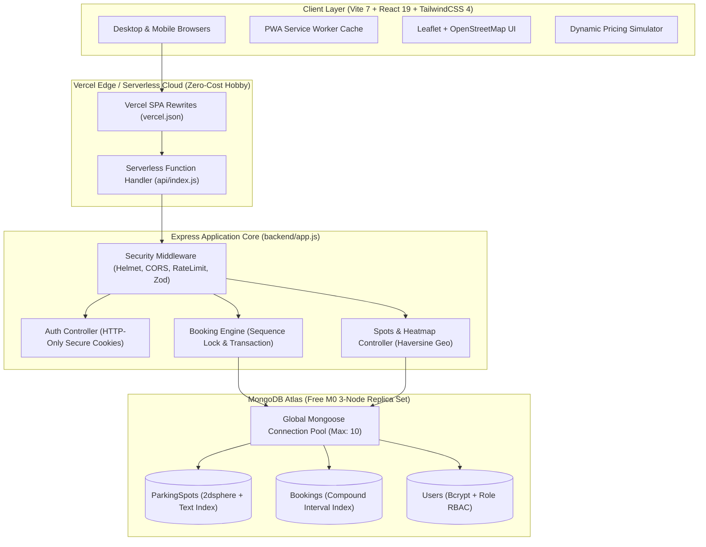

# ParkingFinder 2.0 — Smart Urban Parking Marketplace

[](https://github.com/Krishna200608/ParkingFinder/actions)
[](./test)
[](LICENSE)
[](https://vercel.com)
[](./frontend/public/manifest.json)
[](./frontend)

> A production-grade, two-sided parking marketplace connecting drivers with urban hosts and commercial operators. Engineered with concurrency-safe booking locks, geospatial 2dsphere discovery, OpenStreetMap Nominatim geocoding, algorithmic dynamic pricing, and zero-cost serverless deployment on Vercel and MongoDB Atlas.

---

## 🏛️ System Architecture



---

## 🚀 Key Engineering Differentiators

### 1. Concurrency-Safe Booking Engine
* **The Problem:** In standard reservation systems, two simultaneous requests can check availability concurrently and both pass, causing double bookings.
* **The Engineering Solution:** Implemented transactional execution with document-level serialization in [`backend/controllers/bookings.controller.js`](file:///d:/Web%20D/ParkingFinder/backend/controllers/bookings.controller.js). The engine executes an atomic write lock via `$inc: { bookingSequence: 1 }` on the parking spot inside a MongoDB session with bounded exponential backoff retries (`executeWithRetry`).
* **Concurrency Test:** An automated race-condition test in [`test/booking.test.js`](file:///d:/Web%20D/ParkingFinder/test/booking.test.js) fires simultaneous overlapping booking requests and validates that strictly one succeeds, while the colliding request receives HTTP 409 Conflict.

### 2. Strict Half-Open Interval Collision Logic
* Interval overlap is defined strictly over the half-open interval $[StartTime, EndTime)$:
  $$\text{Overlap} \iff ExistingStart < RequestedEnd \land ExistingEnd > RequestedStart$$
* Exact boundary contiguous reservations (e.g. 10:00–12:00 and 12:00–14:00) share exact minutes without false positive collisions.

### 3. Dynamic Algorithmic Pricing Simulator
* Implemented real-time dynamic pricing model in [`frontend/src/pages/PricingPage.jsx`](file:///d:/Web%20D/ParkingFinder/frontend/src/pages/PricingPage.jsx):
  $$P_{\text{simulated}} = P_{\text{base}} \times \left(1 + \alpha \cdot D + \beta \cdot T_{\text{surge}} + \gamma \cdot E_{\text{premium}}\right)$$
* **Parameters:** Base rate $P_{\text{base}}$, Neighborhood occupancy $D \in [0, 1]$, Demand elasticity $\alpha$, Time-of-day surge $\beta$ (Night $-25\%$, Morning Peak $+35\%$, Midday $+5\%$, Evening Rush $+40\%$), and Amenity premiums $\gamma$ (EV supercharging $+15\%$, covered bay $+10\%$).
* Features an interactive 24-hour curve bar chart and bounded guardrails preventing runaway prices ($P \le 3 \cdot P_{\text{base}}$).

### 4. Geospatial Discovery & Demand Heatmap
* **Geocoding:** Interactive search powered by OpenStreetMap Nominatim with 450ms input debouncing and compliant headers.
* **Haversine Distance:** Computed dynamically on the server and attached to every spot response for localized distance sorting.
* **Heatmap Overlay:** Endpoint `GET /api/spots/demand-heatmap` computes location-weighted demand scores rendered as dynamic radial color-gradient circles on Leaflet.

### 5. Verified Marketplace Reviews
* Drivers can only submit a review on a parking spot if they have a confirmed, completed, or active booking for that spot.
* Unauthorized review attempts are blocked with HTTP 403 Forbidden.

### 6. Zero-Cost Serverless Architecture
* Decoupled into `backend/app.js` (Express app), `backend/server.js` (local runner), and `api/index.js` (Vercel serverless function).
* Global Mongoose connection pool (`global.mongoose = { conn, promise }`) with `maxPoolSize: 10` conserving Atlas free tier connections across serverless warm starts.
* Vite parallel manual chunking (`vendor`, `leaflet`, `ui`) achieving sub-6s production builds.

---

## 📊 Automated Test Coverage

The project includes 25 automated unit and integration tests across 3 comprehensive test suites running in Vitest:

| Test Suite | Scenarios Verified | Passing |
| :--- | :--- | :--- |
| [`test/booking.test.js`](file:///d:/Web%20D/ParkingFinder/test/booking.test.js) | Normal booking, price snapshots, demo statuses, overlap collision (409), contiguous abutting bookings, past time rejection, host self-booking prevention, cancellation audit trail, unauthorized cancellation rejection, and **simultaneous race condition concurrency locking**. | **10 / 10** |
| [`test/discovery.test.js`](file:///d:/Web%20D/ParkingFinder/test/discovery.test.js) | Public retrieval, geospatial radius filtering, Haversine `distanceKm` calculation, `maxPrice`, `amenities`, `vehicleSize`, text keyword search, sort ordering, spot details by ID, and verified driver review gating. | **10 / 10** |
| [`test/host.test.js`](file:///d:/Web%20D/ParkingFinder/test/host.test.js) | Host listings with earnings aggregation, instant availability toggle, incoming driver reservations table, active booking deletion guard (HTTP 400), and clean listing deletion. | **5 / 5** |
| **Total** | **End-to-end full-stack verification across all marketplace flows** | **25 / 25 Passing** |

---

## 🛠️ Technology Stack

| Layer | Technology | Purpose |
| :--- | :--- | :--- |
| **Frontend** | React 19, Vite 7 | Modern reactive client with instant HMR and optimized asset bundling |
| **Styling** | Tailwind CSS 4, Framer Motion | GPU-accelerated responsive animations and glassmorphism styling |
| **Maps** | Leaflet, React-Leaflet, OpenStreetMap | Free-tier mapping, custom markers, popups, and radius overlays |
| **Geocoding** | OpenStreetMap Nominatim | Address & city search geocoding with debounce and custom User-Agent |
| **Backend API** | Node.js 20, Express.js | Decoupled REST API with Helmet security, rate limiting, and Zod validation |
| **Database** | MongoDB Atlas Free (M0), Mongoose 8 | Multi-document replica set transactions and 2dsphere geospatial indexing |
| **Auth** | JWT in HTTP-Only Cookies | Secure, CSRF-resistant cookie-based authentication (`sameSite: 'lax'`) |
| **Deployment** | Vercel Serverless Functions | Serverless deployment via `api/index.js` and `vercel.json` rewrites |
| **CI / CD** | GitHub Actions | Automated workflow validating lint, test suite, and production build |

---

## 📋 Complete REST API Reference

### Authentication (`/api/auth`)
| Method | Route | Access | Description |
| :--- | :--- | :--- | :--- |
| `POST` | `/api/auth/register` | Public | Register new user. Zod schema restricts role to `['driver', 'host']`. |
| `POST` | `/api/auth/login` | Public | Authenticates credentials and sets secure HTTP-only JWT cookie. |
| `POST` | `/api/auth/logout` | Public | Clears JWT cookie and invalidates session. |
| `GET` | `/api/auth/me` | Private | Returns current authenticated user profile. |

### Parking Spaces & Discovery (`/api/spots`)
| Method | Route | Access | Description |
| :--- | :--- | :--- | :--- |
| `GET` | `/api/spots` | Public | Discover spots with multi-filters (`lat`, `lng`, `radius`, `maxPrice`, `amenities`, `vehicleSize`, `search`, `sort`). |
| `GET` | `/api/spots/demand-heatmap` | Public | Returns parking demand density heatmap coordinates. |
| `POST` | `/api/spots/seed` | Public | Seeds 8 realistic demo spots across metro locations idempotently. |
| `GET` | `/api/spots/my` | Private (Host) | Returns host's listings with aggregated earnings and booking counts. |
| `GET` | `/api/spots/:id` | Public | Returns comprehensive spot details, host info, amenities, and reviews. |
| `POST` | `/api/spots` | Private (Host) | Create new parking space listing with coordinates and amenities. |
| `PUT` | `/api/spots/:id` | Private (Owner) | Update spot details or toggle `isAvailable` status. |
| `DELETE` | `/api/spots/:id` | Private (Owner) | Delete spot (guarded against deletion if active bookings exist). |
| `POST` | `/api/spots/:id/reviews` | Private (Driver) | Submit review (requires verified completed booking). |

### Reservations & Bookings (`/api/bookings`)
| Method | Route | Access | Description |
| :--- | :--- | :--- | :--- |
| `POST` | `/api/bookings` | Private (Driver) | Create reservation with concurrency write locks and price snapshot. |
| `GET` | `/api/bookings/me` | Private (Driver) | Returns driver's booking history and active reservations. |
| `GET` | `/api/bookings/host` | Private (Host) | Returns incoming driver reservations for host's parking spaces. |
| `GET` | `/api/bookings/spot/:spotId/availability` | Public | Computes occupied intervals and free contiguous slots for a given date. |
| `GET` | `/api/bookings/:id` | Private (Participant) | Returns single booking details with audit trail. |
| `PUT` | `/api/bookings/:id/cancel` | Private (Driver/Admin) | Cancels booking with audit trail (`cancelledAt`, `cancelledBy`, `reason`). |

### Payments & Checkout (`/api/payments`)
| Method | Route | Access | Description |
| :--- | :--- | :--- | :--- |
| `POST` | `/api/payments/create-checkout-session` | Private (Driver) | Creates Stripe Checkout Session or returns Sandbox Simulator link. |
| `GET` | `/api/payments/verify-session` | Private (Driver) | Verifies session status with Stripe / Simulator and updates booking. |
| `POST` | `/api/payments/simulate-success` | Private (Driver) | Authorizes simulated test card payment in Sandbox mode. |
| `POST` | `/api/payments/webhook` | Public | Stripe webhook listener with cryptographic HMAC signature verification. |
| `GET` | `/api/payments/my-transactions` | Private (Driver) | Retrieves driver's verified payment ledger and receipts. |

---

## ⚡ Quick Start Guide (Local Development)

### 1. Clone & Install
```bash
git clone https://github.com/Krishna200608/ParkingFinder.git
cd ParkingFinder
npm install
```

### 2. Configure Environment Variables
Copy `.env.example` to `.env` in the root (or `backend/.env`):
```env
PORT=5001
MONGO_URI=mongodb+srv://<username>:<password>@cluster0.ix5ng.mongodb.net/parkingfinder?retryWrites=true&w=majority
JWT_SECRET=your_secure_random_jwt_secret_key_here
NODE_ENV=development
```

### 3. Run Development Servers
```bash
# Terminal 1: Start Backend API (Port 5001)
npm run start --prefix backend

# Terminal 2: Start Frontend Client (Port 3000)
npm run start --prefix frontend
```
Visit `http://localhost:3000` in your browser.

### 4. Run Automated Tests & Linter
```bash
# Run Vitest test suite (25 tests)
npm test

# Run ESLint across frontend
npm run lint

# Run production build
npm run build
```

---

## 🌐 Free-Tier Deployment (Vercel + MongoDB Atlas)

1. **MongoDB Atlas:** Create a free M0 Sandbox cluster (512MB, 3-node replica set). Copy the Connection URI.
2. **Push to GitHub:** Commit all verified changes to your repository.
3. **Import into Vercel:**
   - Link your GitHub repository on Vercel.
   - Root Directory: `./` (leave default).
   - Build Command: `npm run build`
   - Output Directory: `frontend/dist`
   - Framework Preset: `Vite`
4. **Environment Variables in Vercel:**
   - `MONGO_URI`: Your MongoDB Atlas connection string.
   - `JWT_SECRET`: A secure random secret string.
   - `NODE_ENV`: `production`
5. **Deploy:** Vercel automatically deploys the frontend SPA and serves API endpoints through `api/index.js` using the routing rules defined in `vercel.json`.

---

## 📄 License
This project is licensed under the [MIT License](LICENSE).
