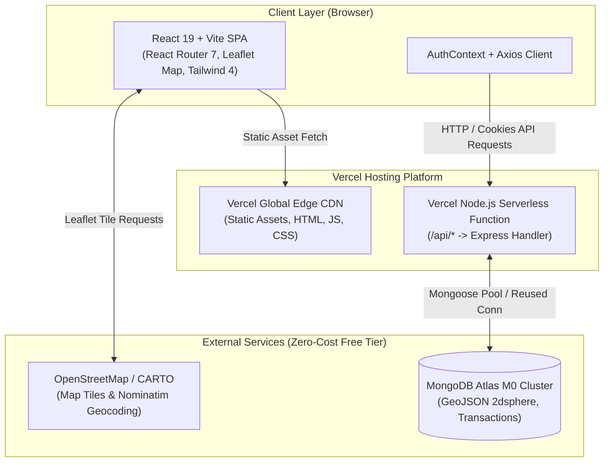

# ParkingFinder 2.0 — Architecture & System Design

## 1. High-Level System Architecture

ParkingFinder is designed as a decoupled full-stack web application hosted on a single unified Vercel deployment. The frontend is built as a Single Page Application (SPA) with React and Vite, served globally via Vercel's Edge Network CDN. The backend is an Express application structured to function as both a standard Node.js server (for local development) and a serverless function handler (`/api/*`) on Vercel Functions. Persistent data and geospatial indexes are managed on MongoDB Atlas Free tier.



---

## 2. Component and Layer Breakdown

### 2.1 Presentation Layer (Frontend)
- **Framework:** React 19 bundled with Vite 7.
- **Routing:** React Router DOM (v7) managing `/`, `/find`, `/login`, `/register`, `/dashboard`, `/host/dashboard`, `/host/add-spot`, `/host/edit-spot/:id`, `/profile`, and informational pages.
- **State Management:** React Context (`AuthContext`) tracking authenticated user identity, role, and session synchronization.
- **Styling & Motion:** Tailwind CSS 4 utility framework complemented by Framer Motion for transitions and Lucide React for iconography.
- **Geospatial UI:** React Leaflet with OpenStreetMap tiles rendering spot coordinates, user location markers, search radius circles, and interactive spot selection popups.

### 2.2 Application / API Layer (Backend)
- **Framework:** Express.js 5 modularized into routers, controllers, and middleware.
- **Security & Middleware:**
  - `cookieParser()` for parsing HTTP-only session cookies.
  - `cors()` configured with explicit origin whitelists.
  - `protect` middleware decoding JWTs and attaching sanitized user models (`req.user`).
  - `isHostOrAdmin` role guard controlling elevated marketplace actions.
  - Planned: `helmet` for secure HTTP headers, `express-rate-limit` for endpoint protection, and `zod` for request payload validation.
- **Serverless Entrypoint:** Decoupled `app.js` configuring middleware and mounting routes without invoking `app.listen()`, invoked by `/api/index.js` in production and `server.js` in development.

### 2.3 Data Layer (Database)
- **Storage:** MongoDB Atlas M0 Cluster with Mongoose ODM 8.
- **Indexing Strategy:**
  - `users`: Unique indexes on `email` and `username`.
  - `parkingSpots`: `2dsphere` geospatial index on `location` for spherical distance queries (`$near`, `$geoNear`); index on `owner`.
  - `bookings`: Compound indexes on `{ spot: 1, startTime: 1, endTime: 1 }` and `{ user: 1, createdAt: -1 }`.

---

## 3. Entity Relationship & Data Models

```mermaid
erDiagram
    USER ||--o{ PARKING_SPOT : "owns / hosts"
    USER ||--o{ BOOKING : "reserves as driver"
    USER ||--o{ BOOKING : "receives as host"
    PARKING_SPOT ||--o{ BOOKING : "is booked for time interval"
    PARKING_SPOT ||--o{ REVIEW : "contains"
    USER ||--o{ REVIEW : "authors"

    USER {
        ObjectId _id PK
        string username UK
        string email UK
        string password "bcrypt hashed"
        string role "driver | host | admin"
        date createdAt
        date updatedAt
    }

    PARKING_SPOT {
        ObjectId _id PK
        ObjectId owner FK
        string spotType "operator | p2p"
        string address
        Point location "GeoJSON Point [lng, lat]"
        string description
        number pricePerHour
        boolean isAvailable
        number rating "average rating"
        array reviews "embedded reviews"
        date createdAt
        date updatedAt
    }

    BOOKING {
        ObjectId _id PK
        ObjectId user FK "driver"
        ObjectId host FK "owner"
        ObjectId spot FK "parking spot"
        date startTime
        date endTime
        number totalCost
        string status "pending | confirmed | active | completed | cancelled"
        string paymentStatus "not_required | unpaid_demo | paid"
        string notes
        date createdAt
        date updatedAt
    }

    REVIEW {
        ObjectId user FK
        number rating "1 to 5"
        string comment
        date createdAt
    }
```



---

## 4. API Endpoint Contracts

### 4.1 Authentication (`/api/auth`)
| Method | Route | Access | Current Implementation | Target Contract |
| :--- | :--- | :--- | :--- | :--- |
| `POST` | `/api/auth/register` | Public | Accepts arbitrary `role`; creates user; sets cookie and returns dual token | Validates input via Zod; forces default role (`driver` or `host`); sets secure HTTP-only cookie |
| `POST` | `/api/auth/login` | Public | Validates email & password; sets cookie and returns dual token | Validates credentials; sets secure HTTP-only cookie; returns user profile metadata |
| `POST` | `/api/auth/logout` | Private | Clears `jwt` cookie with basic options | Clears `jwt` cookie with matching `sameSite`, `secure`, and `path` attributes |
| `GET` | `/api/auth/profile` | Private | Returns `req.user` (`_id`, `username`, `email`, `role`) | Returns complete sanitized user profile |

### 4.2 Parking Spots (`/api/spots`)
| Method | Route | Access | Current Implementation | Target Contract |
| :--- | :--- | :--- | :--- | :--- |
| `GET` | `/api/spots` | Public | Mounted at `/available` with `protect` middleware! Fails for unauthenticated users | Public endpoint supporting query params `lat`, `lng`, `radius`, `spotType`, `minPrice`, `maxPrice`, `sort` |
| `POST` | `/api/spots` | Host/Admin | Mounted at `/available` requiring flat `latitude`, `longitude` | Validated creation endpoint accepting GeoJSON coordinates and full listing attributes |
| `GET` | `/api/spots/my` | Host/Admin | Aggregates earnings and returns host's spots | Returns host's spots with earnings, active bookings count, and utilization stats |
| `GET` | `/api/spots/:id` | Public | Fetches spot by ID with owner & reviews populated | Fetches spot details, ratings, host profile, and verified reviews |
| `PUT` | `/api/spots/:id` | Host/Admin | Owner or admin update | Validated update with ownership check; preserves existing bookings |
| `DELETE` | `/api/spots/:id` | Host/Admin | Hard deletes spot without checking active bookings | Validates that no active/future bookings exist before deletion or archives spot |
| `POST` | `/api/spots/:id/reviews` | Driver | Adds review to spot subdocument; no completed booking check | Validates user has a completed booking for this spot; adds rating and comment; recalculates average rating |

### 4.3 Bookings (`/api/bookings`)
| Method | Route | Access | Current Implementation | Target Contract |
| :--- | :--- | :--- | :--- | :--- |
| `POST` | `/api/bookings` | Driver | Check-then-save overlap; sets `status: 'confirmed'`, `paymentStatus: 'paid'` without payment gateway | Validates time range (`startTime >= now`, `endTime > startTime`); concurrency-safe reservation; demo status `unpaid_demo` |
| `GET` | `/api/bookings/me` | Driver | Returns driver's booking history | Returns driver's bookings with spot and host details populated |
| `GET` | `/api/bookings/:id` | Private | Returns booking if requester is driver, host, or admin | Detailed booking view with status lifecycle and cancellation rules |
| `PUT` | `/api/bookings/:id/cancel`| Private | Driver or admin cancellation; no time window enforcement | Enforces cancellation policy (e.g. at least 1 hour prior to start); restores availability |
| `GET` | `/api/bookings/spot/:spotId` | Public | Accidentally protected by `router.use(protect)`; mutates date objects; today only | Public endpoint; accepts target date; calculates booked and free half-open intervals `[start, end)` |

---

## 5. Geospatial Architecture & Indexing

The platform relies on MongoDB's spherical geometry capabilities:
1. **Coordinate Convention:** GeoJSON standard `[longitude, latitude]` is stored in the database. When interfacing with Leaflet and Nominatim, coordinates are converted to/from Leaflet's `[latitude, longitude]` representation.
2. **Index:** `parkingSpotSchema.index({ location: "2dsphere" })` enables `$near` spherical distance calculations using Earth's curvature.
3. **Query Engine:**
   ```javascript
   query.location = {
     $near: {
       $geometry: {
         type: "Point",
         coordinates: [parseFloat(lng), parseFloat(lat)],
       },
       $maxDistance: parseInt(radiusInMeters, 10),
     },
   };
   ```
4. **Tile Provider & Geocoding Policy:** Standard OpenStreetMap tile servers are utilized with proper attribution. Reverse geocoding via Nominatim enforces custom descriptive `User-Agent` headers and respects strict rate limits (maximum 1 request per second).

---

## 6. Concurrency & Booking Safety Strategy

The primary algorithmic vulnerability in the legacy POC is the race condition during concurrent booking creation:
```
Request A: Checks overlap for Spot X (10:00 - 12:00) -> None found -> Suspends for I/O
Request B: Checks overlap for Spot X (11:00 - 13:00) -> None found -> Saves Booking B
Request A: Resumes -> Saves Booking A (DOUBLE BOOKING OCCURRED)
```

**Target Concurrency Architecture:**
1. **Half-Open Interval Definition:** Interval collisions are defined strictly as:
   $$\text{ExistingStart} < \text{RequestedEnd} \quad \land \quad \text{ExistingEnd} > \text{RequestedStart}$$
   This allows contiguous bookings (e.g. 10:00-11:00 and 11:00-12:00) without false conflict.
2. **MongoDB Transaction / Document Versioning Strategy:**
   - On MongoDB Atlas (which runs replica sets even on M0 Free tiers), multi-document transactions can be utilized with write locks or optimistic document versioning on the `ParkingSpot` record.
   - Alternatively, atomic operations or a slot reservation lock ensure that simultaneous competing requests are serialized, rejecting the second request with HTTP `409 Conflict`.

