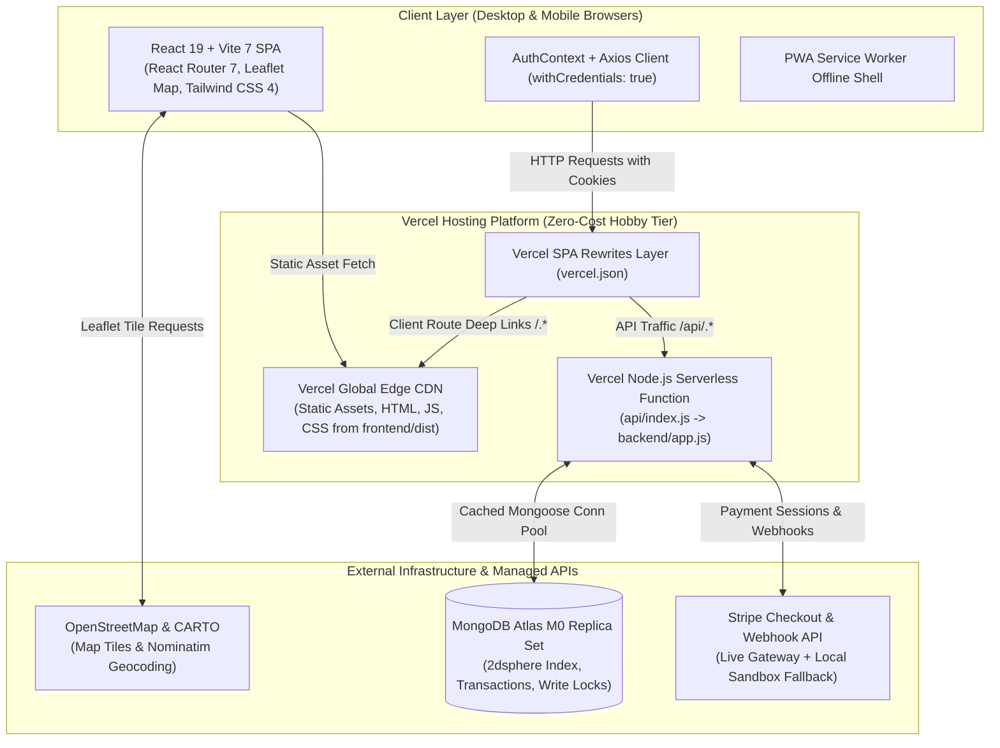
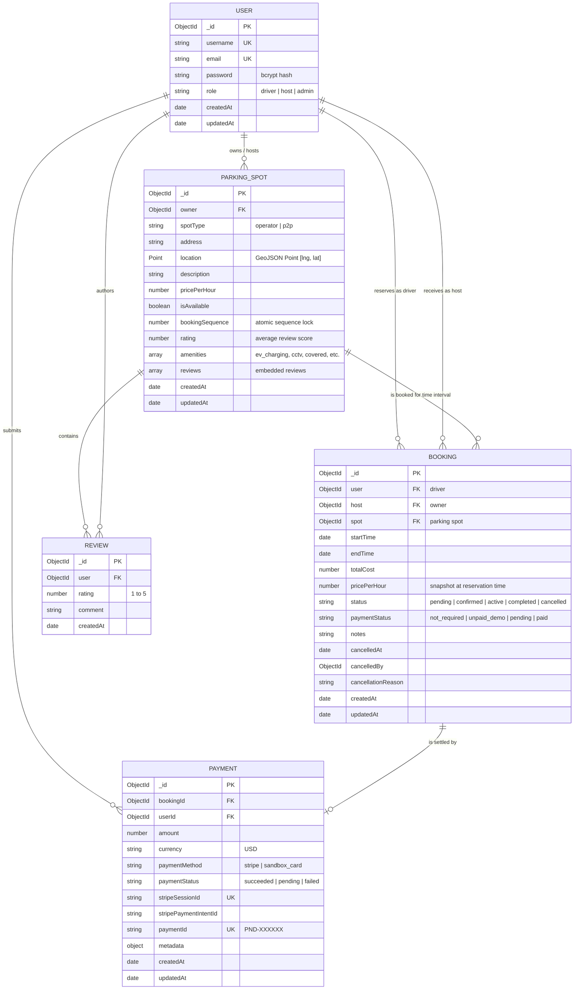

# ParkingFinder 2.0 — Architecture & System Design

## 1. High-Level System Architecture

ParkingFinder is architected as a decoupled full-stack web application running on a unified Vercel deployment. The frontend Single Page Application (SPA) is built with React 19, Vite 7, and Tailwind CSS 4, served globally across Vercel's Edge CDN. The backend is an Express application structured to function both as a traditional Node.js server (for local development) and as a serverless function handler (`/api/*`) on Vercel Functions. Persistent data, transactions, and geospatial indexes are managed on MongoDB Atlas Free Tier (M0 3-Node Replica Set).



---

## 2. Component and Layer Breakdown

### 2.1 Presentation Layer (Frontend)
* **Framework:** React 19 compiled with Vite 7.
* **Routing:** React Router 7 supporting 15 distinct routes:
  * Public Discovery & Marketing: `/` (Home), `/find` (Geospatial Discovery), `/spots/:id` (Spot Details), `/pricing` (Tiers & Simulator), `/about` (Company Story), `/contact` (Support).
  * Authentication: `/login`, `/register`.
  * Driver Portal: `/dashboard` (Reservations & Receipts), `/profile` (User Account).
  * Host Portal: `/host/dashboard` (Listings & Incoming Bookings), `/host/add-spot` (Listing Creation), `/host/edit-spot/:id` (Listing Management).
  * Payment Workflows: `/checkout-simulator` (Local Sandbox), `/booking-success` (Payment Return & Verification).
* **Decoupled Layout Architecture:**
  * **Full-Viewport Map Shell (`/find`):** Bypasses standard page containers; establishes a flexbox viewport (`h-[calc(100vh-65px)] overflow-hidden`) with a synchronized split-view between listing cards (~440px) and a 100% interactive Leaflet map. Footers are unmounted automatically to prioritize discovery real estate.
  * **Standard Editorial Shell (All Other Routes):** Centered containers (`max-w-6xl` / `max-w-5xl`) with standardized padding (`px-4 sm:px-6`), high-contrast typography, and full corporate footer.
* **Modular UI Primitives (`frontend/src/components/ui/`):**
  * `Button`: Polymorphic button/link supporting 5 variants (`primary`, `secondary`, `outline`, `ghost`, `danger`) and 3 sizes.
  * `Card`: Elevated `#FFFFFF` container with 1px `#DDE3EA` border and subtle hover transitions.
  * `Badge` / `StatusBadge`: Unified status indicators with semantic color tokens (`Paid`, `Demo Reserved`, `Pending`, `Available`, `Cancelled`).
  * `PageHeader`: Editorial page headers with dynamic breadcrumbs and action slots.
  * `Tabs`: Segmented tab switcher with active indicator pills.
  * `EmptyState`: Accessible zero-data illustrations with primary call-to-action buttons.

### 2.2 Application / API Layer (Backend)
* **Framework:** Express.js decoupled into routers, controllers, and middleware.
* **Security & Reliability Middleware:**
  * `helmet()`: Enforces HTTP security headers (X-DNS-Prefetch-Control, X-Frame-Options, Strict-Transport-Security, etc.).
  * `cors()`: Configured with explicit origin whitelists and `credentials: true`.
  * `cookieParser()`: Parses HTTP-only session cookies.
  * `express-rate-limit`: Rate limiting on public auth and search endpoints to prevent brute-force attacks.
  * `zod`: Schema-driven request payload validation for registration and booking creation.
  * `errorHandler`: Centralized error middleware normalizing status codes and preventing stack trace exposure.
* **Authentication Middleware:**
  * `protect`: Verifies JWT from HTTP-only cookie, decodes user payload, and attaches sanitized user object to `req.user`.
  * `isHostOrAdmin`: Restricts host-specific operations (creating spots, updating listings, reviewing incoming host reservations).
* **Decoupled Entrypoints:**
  * `backend/app.js`: Configures all middleware and routes without invoking `app.listen()`.
  * `backend/server.js`: Connects to MongoDB Atlas and starts local HTTP listener on port 5001.
  * `api/index.js`: Serverless handler invoked dynamically by Vercel upon `/api/*` requests.

### 2.3 Data Layer (Database)
* **Storage:** MongoDB Atlas Free Tier (M0 Replica Set, 512 MB storage).
* **Connection Lifecycle:** Global Mongoose connection caching (`global.mongoose = { conn, promise }`) with `maxPoolSize: 10` preventing connection pool exhaustion across serverless warm starts.
* **Index Strategy:**
  * `users`: Unique indexes on `email` and `username`.
  * `parkingSpots`: `2dsphere` geospatial index on `location` for spherical distance queries; secondary index on `owner`.
  * `bookings`: Compound index on `{ spot: 1, startTime: 1, endTime: 1 }` and secondary index on `{ user: 1, createdAt: -1 }`.
  * `payments`: Indexes on `bookingId`, `userId`, `stripeSessionId`, and `paymentId`.

---

## 3. Entity Relationship & Data Models



---

## 4. API Endpoint Contracts

### 4.1 Authentication (`/api/auth`)
| Method | Route | Access | Description |
| :--- | :--- | :--- | :--- |
| `POST` | `/api/auth/register` | Public | Registers a new user. Zod schema restricts role to `driver` or `host`. Sets secure HTTP-only JWT cookie. |
| `POST` | `/api/auth/login` | Public | Validates credentials via bcrypt and sets secure HTTP-only JWT cookie. |
| `POST` | `/api/auth/logout` | Public | Clears `jwt` cookie with matching `sameSite`, `secure`, and `path` options. |
| `GET` | `/api/auth/me` | Authenticated | Returns current authenticated user profile (`_id`, `username`, `email`, `role`). |

### 4.2 Parking Spaces & Discovery (`/api/spots`)
| Method | Route | Access | Description |
| :--- | :--- | :--- | :--- |
| `GET` | `/api/spots` | Public | Discover spots with multi-variable filters (`lat`, `lng`, `radius`, `maxPrice`, `amenities`, `vehicleSize`, `search`, `sort`). Dynamically computes Haversine `distanceKm`. |
| `GET` | `/api/spots/demand-heatmap` | Public | Aggregates reservation density to return geospatial demand hotspot coordinates and weights. |
| `POST` | `/api/spots/seed` | Public | Seeds 8 realistic demo spots across metro locations idempotently. |
| `GET` | `/api/spots/my` | Host Only | Returns host's listings with aggregated earnings, active booking counts, and utilization stats. |
| `GET` | `/api/spots/:id` | Public | Fetches spot details, host profile, amenities, and verified driver reviews. |
| `POST` | `/api/spots` | Host Only | Creates a new parking space with coordinates, pricing, and amenities. |
| `PUT` | `/api/spots/:id` | Listing Owner | Updates listing details or toggles instant availability (`isAvailable`). |
| `DELETE` | `/api/spots/:id` | Listing Owner | Deletes spot; guarded against deletion if active reservations exist (`HTTP 400`). |
| `POST` | `/api/spots/:id/reviews` | Verified Driver | Submits a rating and comment (strictly requires an active or completed booking). |

### 4.3 Reservations & Bookings (`/api/bookings`)
| Method | Route | Access | Description |
| :--- | :--- | :--- | :--- |
| `POST` | `/api/bookings` | Driver Only | Creates reservation with transactional sequence write lock, price snapshot, and collision validation. |
| `GET` | `/api/bookings/me` | Driver Only | Returns driver's booking history and active reservations populated with spot details. |
| `GET` | `/api/bookings/host` | Host Only | Returns incoming driver reservations for host's parking spaces. |
| `GET` | `/api/bookings/spot/:spotId/availability` | Public | Computes occupied intervals and free contiguous slots for a given target date. |
| `GET` | `/api/bookings/:id` | Participant | Detailed booking view with status lifecycle and audit trail. |
| `PUT` | `/api/bookings/:id/cancel` | Booking Owner | Cancels reservation with full audit trail (`cancelledAt`, `cancelledBy`, `reason`) and restores availability. |

### 4.4 Payments & Checkout (`/api/payments`)
| Method | Route | Access | Description |
| :--- | :--- | :--- | :--- |
| `POST` | `/api/payments/create-checkout-session` | Driver Only | Creates a Stripe Checkout Session or returns local Sandbox Simulator link. Updates booking status to `pending`. |
| `GET` | `/api/payments/verify-session` | Driver Only | Verifies session status with Stripe / Simulator and updates booking payment status. |
| `POST` | `/api/payments/simulate-success` | Driver Only | Authorizes simulated test card payment in Sandbox mode and writes immutable Payment record. |
| `POST` | `/api/payments/webhook` | Public | Cryptographic HMAC SHA-256 webhook listener syncing reservation status upon payment completion. |
| `GET` | `/api/payments/my-transactions` | Driver Only | Retrieves driver's verified payment ledger with receipts and transaction IDs. |

### 4.5 System Health (`/api/health`)
| Method | Route | Access | Description |
| :--- | :--- | :--- | :--- |
| `GET` | `/api/health` | Public | Returns system uptime, timestamp, and active MongoDB connection status. |

---

## 5. Geospatial Architecture & Indexing

The platform leverages MongoDB spherical geometry for high-performance spatial queries:

1. **Coordinate Format:** Stored as standard GeoJSON Point `[longitude, latitude]`. When interfacing with Leaflet and Nominatim, coordinates are cleanly transformed to/from Leaflet's `[latitude, longitude]` convention.
2. **2dsphere Index:** Indexed via `parkingSpotSchema.index({ location: "2dsphere" })` enabling spherical distance calculations across Earth's curvature.
3. **Query Engine:**
   ```javascript
   query.location = {
     $nearSphere: {
       $geometry: {
         type: "Point",
         coordinates: [parseFloat(lng), parseFloat(lat)],
       },
       $maxDistance: parseInt(radiusInMeters, 10),
     },
   };
   ```
4. **Haversine Distance Formulation:** When query coordinates are provided, the server computes the great-circle distance $d$ in kilometers for every spot:
   $$a = \sin^2\left(\frac{\Delta \phi}{2}\right) + \cos(\phi_1) \cos(\phi_2) \sin^2\left(\frac{\Delta \lambda}{2}\right)$$
   $$d = 2 R \cdot \operatorname{atan2}\left(\sqrt{a}, \sqrt{1 - a}\right)$$
   where $R = 6371\text{ km}$, $\phi$ is latitude in radians, and $\lambda$ is longitude in radians.
5. **Demand Heatmap Aggregation:** An aggregation pipeline calculates regional demand density from confirmed reservations, returning location-weighted coordinates rendered as dynamic radial heat circles on Leaflet.

---

## 6. Concurrency & Booking Safety Strategy

### 6.1 The Double-Booking Vulnerability
In standard reservation systems, two concurrent requests can check availability simultaneously against uncommitted database state:
```
Request A: Checks overlap for Spot X (10:00 - 12:00) -> None found -> Suspends for I/O
Request B: Checks overlap for Spot X (11:00 - 13:00) -> None found -> Saves Booking B
Request A: Resumes -> Saves Booking A (DOUBLE BOOKING OCCURRED)
```

### 6.2 Strict Half-Open Interval Collision Logic
Interval collisions are evaluated strictly over the half-open temporal interval $[StartTime, EndTime)$:
$$\text{Overlap} \iff \text{ExistingStart} < \text{RequestedEnd} \land \text{ExistingEnd} > \text{RequestedStart}$$
This ensures that contiguous reservations (e.g. 10:00–12:00 and 12:00–14:00) share exact minute boundaries without false-positive collisions.

### 6.3 Transactional Serialization with Sequence Write Locks
To eliminate the Time-of-Check to Time-of-Use (TOCTOU) race condition:
1. Every reservation creation begins an explicit MongoDB multi-document transaction session.
2. The engine executes an atomic write lock on the parking spot document:
   ```javascript
   await ParkingSpot.findByIdAndUpdate(
     spotId,
     { $inc: { bookingSequence: 1 } },
     { session, new: true }
   );
   ```
   This guarantees write serialization at the database engine level; competing transactions on the same spot are forced into a sequential order.
3. Overlap queries execute within the serialized session. If an overlap is detected, the transaction aborts and returns `HTTP 409 Conflict`.
4. Bounded exponential backoff retries (`executeWithRetry`) handle transient write conflict exceptions gracefully.
5. Concurrency validation is proven via an automated test in `test/booking.test.js` firing simultaneous overlapping requests.

---

## 7. Dynamic Algorithmic Pricing Engine

The platform incorporates real-time algorithmic pricing modeling yield across urban parking bays:

$$P_{\text{simulated}} = P_{\text{base}} \times \left(1 + \alpha \cdot D + \beta \cdot T_{\text{surge}} + \gamma \cdot E_{\text{premium}}\right)$$

* **Base Rate ($P_{\text{base}}$):** Host-configured standard hourly rate.
* **Occupancy Density ($D \in [0, 1]$):** Real-time local occupancy percentage in the surrounding geospatial radius.
* **Demand Elasticity ($\alpha$):** Parameter weighting sensitivity to occupancy ($0.3$ to $0.7$).
* **Time-of-Day Surge ($\beta$):** Temporal surge coefficients:
  * Night (00:00 – 06:00): $-25\%$
  * Morning Peak (07:00 – 10:00): $+35\%$
  * Midday Normal (11:00 – 16:00): $+5\%$
  * Evening Rush (17:00 – 20:00): $+40\%$
* **Amenity Premiums ($\gamma$):** Value multipliers for premium facilities (EV Supercharging $+15\%$, Covered Bay $+10\%$).
* **Safety Guardrails:** Rates are mathematically clamped between an absolute floor of $\$1.00/\text{hr}$ and an upper safety ceiling of $3 \cdot P_{\text{base}}$ to prevent price gouging.
