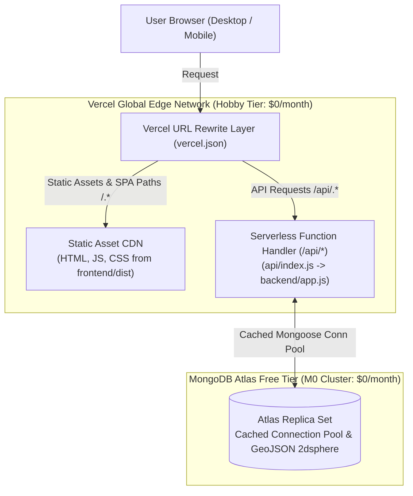

# ParkingFinder 2.0 — Production Deployment Guide (Vercel Free + MongoDB Atlas)

## 1. Zero-Cost Deployment Architecture

ParkingFinder is architected for continuous zero-cost hosting utilizing **Vercel Hobby** (Frontend CDN + Serverless Node.js Functions) paired with **MongoDB Atlas Free Tier** (M0 Replica Set).



---

## 2. Serverless Express & Connection Architecture

### 2.1 Decoupled Application Architecture
* **Application Core (`backend/app.js`):** Configures Helmet, CORS, cookie parser, rate limiters, Zod validation, error middleware, and API routes without invoking `app.listen()`.
* **Local Dev Server (`backend/server.js`):** Awaits database connection before starting local HTTP listener on port 5001.
* **Serverless Entrypoint (`api/index.js`):** Invoked dynamically on Vercel upon `/api/*` traffic; dispatches to Express app with cached database pooling.

### 2.2 Mongoose Connection Caching (`backend/db.js`)
In serverless runtimes, unmanaged connection opens exhaust database connections during traffic spikes. The connection is cached globally:
```javascript
let cached = global.mongoose || (global.mongoose = { conn: null, promise: null });

const connectDB = async () => {
  if (cached.conn && mongoose.connection.readyState === 1) return cached.conn;
  if (!cached.promise) {
    cached.promise = mongoose.connect(process.env.MONGO_URI, {
      bufferCommands: false,
      maxPoolSize: 10,
      serverSelectionTimeoutMS: 8000,
    });
  }
  cached.conn = await cached.promise;
  return cached.conn;
};
```

### 2.3 Routing Configuration (`vercel.json`)
* `/api/(.*)` rewrites to `/api/index.js`
* `/(.*)` rewrites to `/index.html` (resolving client-side deep links on refresh for `/find`, `/dashboard`, `/host/dashboard`, etc.)

---

## 3. Step-by-Step Manual Deployment Guide

### Phase 1: MongoDB Atlas Free Cluster Setup
1. Log in to [MongoDB Atlas](https://cloud.mongodb.com/).
2. Click **Create** > Choose **M0 Free (Shared Cluster)**.
3. Select your nearest cloud provider region (e.g., AWS `ap-south-1` Mumbai or closest geographic region).
4. Under **Security > Database Access**:
   * Create a database user (e.g., `parking_admin`).
   * Assign the **Read and write to any database** built-in role.
   * Generate a strong password and save it securely.
5. Under **Security > Network Access**:
   * Click **Add IP Address**.
   * Select **Allow Access from Anywhere** (`0.0.0.0/0`) to allow dynamic Vercel serverless IP connections.
6. In **Database Deployments**, click **Connect** > **Drivers** > **Node.js**:
   * Copy the connection string format:
     `mongodb+srv://<username>:<password>@cluster0.xxxxx.mongodb.net/parkingfinder?retryWrites=true&w=majority`
   * Replace `<username>` and `<password>` with your database credentials.

---

### Phase 2: Vercel Project Setup
1. Push your repository commits to GitHub (`https://github.com/Krishna200608/ParkingFinder`).
2. Log in to [Vercel](https://vercel.com/) and click **Add New > Project**.
3. Import the `Krishna200608/ParkingFinder` repository.
4. In the **Configure Project** screen, configure:
   * **Framework Preset:** `Vite`
   * **Root Directory:** `./` (Leave as repository root)
   * **Build Command:** `npm run build` (Builds frontend assets into `frontend/dist`)
   * **Output Directory:** `frontend/dist`
   * **Install Command:** `npm install`
5. Expand **Environment Variables** and add:

| Key | Value | Description | Required |
| :--- | :--- | :--- | :--- |
| `NODE_ENV` | `production` | Enables production security optimizations | Yes |
| `MONGO_URI` | `mongodb+srv://...` | MongoDB Atlas replica set connection string | Yes |
| `JWT_SECRET` | `your-32-char-random-secret` | High-entropy random cryptographic key | Yes |
| `STRIPE_SECRET_KEY` | `sk_test_...` | Stripe API Secret Key (if omitted, Sandbox Mode activates) | Optional |
| `STRIPE_WEBHOOK_SECRET` | `whsec_...` | Stripe Webhook Secret for HMAC verification | Optional |

6. Click **Deploy**.

---

## 4. Automated CI/CD Pipeline Configuration

The repository includes an enterprise-grade GitHub Actions workflow (`.github/workflows/ci.yml`) that validates every push and pull request against production constraints:

* **Runner Environment:** Ubuntu Latest with Node.js 22 LTS.
* **Database Service Container:** A dedicated MongoDB 7.0 container configured with replica set clustering:
  ```yaml
  services:
    mongodb:
      image: mongo:7.0
      ports:
        - 27017:27017
      options: >-
        --replSet rs0
        --health-cmd "mongosh --eval 'rs.status().ok || rs.initiate().ok'"
        --health-interval 10s
        --health-timeout 5s
        --health-retries 5
  ```
  This configuration enables multi-document transactions during CI test execution, allowing all 34 Vitest integration tests (including atomic sequence write locks) to execute deterministically without external database dependencies.
* **Automated Pipeline Steps:**
  1. Dependencies installation (`npm ci`).
  2. Frontend ESLint validation (`npm run lint`).
  3. Full Vitest test suite execution (`npm test`).
  4. Production asset compilation (`npm run build`).

---

## 5. Post-Deployment Smoke-Test Verification Runbook

Perform this sequential check immediately after deployment completes:

1. **Static App Loading:**
   * Navigate to `https://<your-project>.vercel.app/`
   * Verify that the hero banner, navigation, and icons render cleanly without broken asset paths.
2. **Deep-Link SPA Refresh:**
   * Navigate to `https://<your-project>.vercel.app/find`
   * Press browser Refresh (F5). Verify that the full-viewport map loads without 404 errors.
3. **API Health Endpoint:**
   * Open `https://<your-project>.vercel.app/api/health`
   * Expected response:
     ```json
     {
       "status": "ok",
       "timestamp": "...",
       "uptime": 1.2,
       "db": "connected"
     }
     ```
4. **User Registration & Cookie Issuance:**
   * Open `/register` and create a driver account.
   * In DevTools (Application > Cookies), verify that the `jwt` cookie is set with `HttpOnly`, `Secure`, and `SameSite=Lax`.
5. **Driver Login & Dashboard:**
   * Log in with the registered driver credentials.
   * Navigate to `/dashboard` and confirm the page loads without authentication errors.
6. **Geospatial Spot Discovery:**
   * Open `/find`. Verify that parking spot markers appear on the Leaflet map and the list renders nearby spots.
7. **Reservation Creation & Payment Checkout:**
   * Click a parking spot, select an available time window, and click Reserve.
   * In the booking dialog, choose either instant demo reservation or Stripe Checkout.
   * If Sandbox mode is active, complete the simulated payment via `/checkout-simulator` and verify redirection to `/booking-success`.
8. **Payment Verification & Receipts:**
   * Open `/dashboard`. Confirm the reservation appears with `Paid` status.
   * Switch to the **Payment Receipts** tab and verify the immutable transaction reference (`PND-XXXXXX`).
9. **Reservation Cancellation:**
   * In `/dashboard`, cancel an eligible reservation.
   * Verify that the status updates to `cancelled` and availability is restored.
10. **Host Spot Creation:**
    * Register or switch to a host account.
    * Navigate to `/host/add-spot`. Drop a pin on the interactive map, set hourly pricing, select amenities, and submit.
    * Verify the spot appears on the host dashboard and in the `/find` map view.
