# ParkingFinder 2.0 — Implementation Roadmap & Execution Log

## 1. Staged Roadmap Overview

The revival of ParkingFinder was organized into ten structured, incremental engineering stages (Stage 0 through Stage 9). Deployment to Vercel was established early (Stage 2) so all advanced features were verified directly against cloud and serverless constraints.

```mermaid
flowchart LR
    S0["Stage 0: Audit\n(Complete)"] --> S1["Stage 1: Security\n& Cleanup\n(Complete)"]
    S1 --> S2["Stage 2: Vercel\nDeployment\n(Complete)"]
    S2 --> S3["Stage 3: Booking\nEngine\n(Complete)"]
    S3 --> S4["Stage 4: Discovery\n& Maps\n(Complete)"]
    S4 --> S5["Stage 5: Host Hub\n& Reviews\n(Complete)"]
    S5 --> S6["Stage 6: Advanced\nDifferentiators\n(Complete)"]
    S6 --> S7["Stage 7: QA, CI/CD\n& Release\n(Complete)"]
    S7 --> S8["Stage 8: Stripe\n& Sandbox\n(Complete)"]
    S8 --> S9["Stage 9: UI/UX\nRedesign\n(Complete)"]
```

---

## 2. Milestone Breakdown & Deliverables

### Stage 0: Repository Discovery & Technical Audit
- **Objective:** Establish an accurate, verified technical baseline across the codebase, identifying critical bugs, security vulnerabilities, and deployment blockers.
- **Key Deliverables:**
  - Complete code, package, and dependency inspection.
  - Verification of runtime behavior, linting errors, and build pipeline.
  - Baseline architecture documentation and specialized audit reports published to `docs/audits/`.
- **Status:** Completed.

### Stage 1: Security & Architecture Cleanup
- **Objective:** Secure credentials, remediate authentication conflicts, fix ESLint errors, and establish resilient API hygiene.
- **Key Deliverables:**
  - Untracked and purged `localhost-key.pem`, `localhost.pem`, `mkcert.exe`, and zip archives from Git.
  - Updated `.gitignore` and authored sanitized `.env.example`.
  - Refactored `vite.config.js` to make HTTPS optional for local development.
  - Unified authentication to a strict HTTP-only cookie strategy (`sameSite: 'lax'`, `secure: production`).
  - Eliminated public registration role escalation (Zod schema whitelisting `driver` and `host`).
  - Introduced `helmet`, `express-rate-limit`, centralized error middleware, and `zod` input validation.
  - Resolved all frontend ESLint errors and warnings.
- **Status:** Completed.

### Stage 2: Vercel Deployment Foundation
- **Objective:** Deploy the full-stack application on Vercel Hobby paired with MongoDB Atlas Free Tier.
- **Key Deliverables:**
  - Decoupled Express server (`app.js`) from network listener (`server.js`).
  - Implemented Vercel serverless entrypoint (`api/index.js`).
  - Implemented global Mongoose connection pooling and caching across serverless invocations (`global.mongoose`).
  - Configured `vercel.json` with client-side SPA rewrites and API route proxies.
  - Live deployment smoke-tested and verified.
- **Status:** Completed.

### Stage 3: Core Booking Engine & Concurrency Safety
- **Objective:** Build an enterprise-grade reservation system with robust concurrency protection and accurate demo statuses.
- **Key Deliverables:**
  - Refactored Booking model: price snapshotting, detailed notes, explicit status enum.
  - Half-open interval availability calculation: $[StartTime, EndTime)$.
  - Server-side validation rejecting past dates, reversed ranges, or self-booking by hosts.
  - Database-level write lock serialization: `$inc: { bookingSequence: 1 }` inside MongoDB multi-document transactions with bounded retry backoff loops (`executeWithRetry`).
  - Automated concurrency test firing simultaneous overlapping requests and asserting strictly one succeeds (`HTTP 409 Conflict` on colliding request).
- **Status:** Completed.

### Stage 4: Modern Parking Discovery & Geospatial UX
- **Objective:** Enhance driver discovery with synchronized map/list interactions and advanced filtering.
- **Key Deliverables:**
  - Clean public endpoints for `/api/spots` with geospatial `$nearSphere` queries and Haversine distance sorting.
  - Synchronized selection between Leaflet markers and spot cards (hover/click flyTo).
  - Search by locality/address with compliant Nominatim rate limiting (450ms debounce and custom User-Agent).
  - Multi-variable filters: price range, distance radius, amenities, vehicle size.
  - Dedicated parking spot detail page with photos, amenities, host profile, mini-map, and reviews.
  - Verified review system: Enforces prerequisite of an active or completed booking before submitting a review.
- **Status:** Completed.

### Stage 5: Host Marketplace & Administration
- **Objective:** Complete the two-sided marketplace with host management, listing analytics, and operational oversight.
- **Key Deliverables:**
  - Host listing CRUD: Title, description, amenities, vehicle sizing, access instructions.
  - Interactive Leaflet pin-picker and reverse geocoding in listing creation and editing forms.
  - Host reservation management: View incoming driver bookings, driver details, and contact info.
  - Instant availability toggle via `PUT /api/spots/:id`.
  - Active booking deletion guard (`HTTP 400`) preventing hosts from deleting spots with pending/active reservations.
  - Host performance analytics: Aggregated gross earnings, total reservations, active bays, and average rating.
- **Status:** Completed.

### Stage 6: Advanced Technical Differentiators
- **Objective:** Implement advanced resume-grade engineering features demonstrating analytical and architectural depth.
- **Key Deliverables:**
  - **Parking Demand Heatmap:** Aggregation pipeline grouping reservations into geospatial clusters; rendered as dynamic radial circles on Leaflet.
  - **Dynamic Pricing Simulator:** Rule-based algorithm adjusting spot base rates by local occupancy density, demand elasticity, time-of-day surge, and amenity premiums with safety guardrail clamps.
  - **EV Charging Attributes & Filters:** Specialized EV charger types, power ratings, and connector filters.
  - **PWA Capabilities:** Web app manifest, service worker caching for offline app shell, installability.
- **Status:** Completed.

### Stage 7: Quality Assurance, CI/CD & Final Polish
- **Objective:** Establish automated testing, GitHub Actions CI pipeline, performance tuning, and resume-ready documentation.
- **Key Deliverables:**
  - Vitest + Supertest integration test suites running against a live MongoDB replica set.
  - GitHub Actions CI pipeline on Node 22 LTS with dedicated single-node replica set (`--replSet rs0` initialized via `rs.initiate()`).
  - Vite manual chunking (`vendor`, `leaflet`, `ui`, `index`) achieving sub-6s production builds.
  - Zero-emoji enterprise README with architectural diagrams, test matrices, and API references.
- **Status:** Completed.

### Stage 8: Stripe Test Mode & Sandbox Payments
- **Objective:** Implement full-lifecycle payment workflows with Stripe Checkout, cryptographic webhook signatures, and resilient sandbox simulation.
- **Key Deliverables:**
  - Stripe Checkout Session creation (`POST /api/payments/create-checkout-session`).
  - Webhook listener with HMAC SHA-256 signature verification (`POST /api/payments/webhook`).
  - Instant sandbox simulator (`/checkout-simulator`) for zero-cost review without live credit cards.
  - Return & verification page (`/booking-success`).
  - Immutable financial transactions ledger (`Payment` model) and driver transactions view (`GET /api/payments/my-transactions`).
  - Vitest integration test suite (9 tests passing).
- **Status:** Completed.

### Stage 9: Full UI/UX Redesign & Modular Design System
- **Objective:** Completely replace the template-like AI aesthetic (repetitive blue-purple gradients, generic oversized pills, artificial testimonials) with a bespoke, professional **Premium Urban Mobility Marketplace** design language.
- **Key Deliverables:**
  - Modular UI primitive library (`frontend/src/components/ui/`): `Button`, `Card`, `Badge`, `StatusBadge`, `PageHeader`, `Tabs`, `EmptyState`.
  - Neutral-first semantic color tokens: `#17243A` text, `#2563EB` primary blue, `#F4F6F8` canvas, `#FFFFFF` surfaces, `#DDE3EA` 1px borders.
  - Decoupled viewport layout shells: Full-viewport split-view discovery canvas on `/find` with synchronized card/marker selection and automatic Leaflet tile resize listeners.
  - Transformed all 15 pages: Home, Find, Spot Details, Booking Modal, Driver Dashboard, Host Dashboard, Pricing, Add/Edit Spot, Auth, Profile, About, Contact, Checkout Simulator, Booking Success.
  - High-contrast accessible typography meeting WCAG AA standards.
  - Complete removal of misleading fake toasts and metrics, replaced with genuine technical differentiators and honest fallback channels.
- **Status:** Completed.

---

## 3. Prioritized Feature Matrix

| Feature | Category | Priority | Status | Engineering Depth |
| :--- | :--- | :--- | :--- | :--- |
| **Vercel Serverless Deployment** | Infrastructure | **P0** | **Completed** | Decoupled serverless handler with cached Mongoose pooling |
| **Unified Cookie Authentication & RBAC** | Security | **P0** | **Completed** | Strict HTTP-only cookies, SameSite=Lax, Zod schemas |
| **Double-Booking Concurrency Safeguards** | Core Engine | **P0** | **Completed** | Atomic `$inc: bookingSequence` write locks in transactions |
| **Payment Gateway & Sandbox Simulation** | Monetization | **P0** | **Completed** | Stripe API + Sandbox Simulator with HMAC SHA-256 webhooks |
| **Premium Urban Mobility Design System** | UI / UX | **P0** | **Completed** | Bespoke component primitives, neutral tokens, decoupled shells |
| **Geospatial Discovery & Synchronized Map** | Core Feature | **P1** | **Completed** | Split-view Leaflet discovery, Nominatim search, radius filter |
| **Driver & Host Dashboards** | Core Feature | **P1** | **Completed** | Reservation management, payment ledger, host metrics |
| **Multi-Day & Flexible Booking Engine** | Core Feature | **P1** | **Completed** | Half-open intervals `[start, end)` with dynamic slot picker |
| **Verified Review & Rating System** | Marketplace | **P2** | **Completed** | Gated strictly behind verified active or completed bookings |
| **Parking Demand Heatmap** | Advanced Analytics | **P2** | **Completed** | Aggregation pipeline rendering density heat circles |
| **Dynamic Pricing Simulator** | Advanced Feature | **P2** | **Completed** | 3-factor dynamic pricing formula with 24-hr yield chart |
| **PWA & Offline Shell** | Web Performance | **P3** | **Completed** | Web app manifest and service worker caching |
