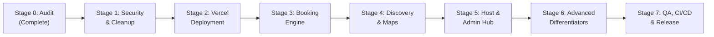

# ParkingFinder 2.0 — Implementation Roadmap

## 1. Staged Roadmap Overview

The revival of ParkingFinder is organized into eight structured, incremental engineering stages. Deployment to Vercel is prioritized early (Stage 2) so all advanced features are developed and verified directly against production constraints.

---

## 2. Milestone Breakdown & Deliverables

### Stage 0: Repository Discovery & Technical Audit (Current)
- **Objective:** Establish an accurate, verified technical baseline across the codebase, identifying critical bugs, security vulnerabilities, and deployment blockers.
- **Key Deliverables:**
  - Complete code and dependency inspection.
  - Verification of runtime behavior, linting, and build pipeline.
  - Creation of baseline system documentation and specialized audit reports.
- **Exit Criteria:** Audit documents published; zero untested assumptions; baseline approved.

### Stage 1: Security & Architecture Cleanup
- **Objective:** Secure credentials, remediate authentication conflicts, fix ESLint errors, and establish resilient API hygiene.
- **Key Deliverables:**
  - Untrack and purge `localhost-key.pem`, `localhost.pem`, `mkcert.exe`, and `parking-finder.zip`.
  - Update `.gitignore` and create sanitized `.env.example` templates.
  - Refactor `vite.config.js` to make HTTPS optional for local development.
  - Unify authentication to a strict HTTP-only cookie strategy (`sameSite: 'lax'`, `secure: production`).
  - Eliminate public registration role escalation (whitelist allowed roles; default to `driver`).
  - Introduce `helmet`, `express-rate-limit`, centralized error middleware, and `zod` input validation.
  - Fix all 9 ESLint errors and 4 warnings.
- **Exit Criteria:** Clean frontend lint and build; secure authentication contract verified.

### Stage 2: Vercel Deployment Foundation
- **Objective:** Deploy the full-stack application on Vercel Hobby with MongoDB Atlas Free.
- **Key Deliverables:**
  - Decouple Express server (`app.js`) from network listener (`server.js`).
  - Implement Vercel serverless entrypoint (`api/index.js`).
  - Implement Mongoose connection pooling and caching across serverless invocations.
  - Configure `vercel.json` with client-side SPA rewrites and API route proxies.
  - Configure environment variables on Vercel dashboard (`MONGO_URI`, `JWT_SECRET`, `NODE_ENV`).
  - Live production URL smoke-tested and verified.
- **Exit Criteria:** Public live URL functional for both frontend SPA routes and backend API endpoints.

### Stage 3: Core Booking Engine & Concurrency Safety
- **Objective:** Build an enterprise-grade reservation system with robust concurrency protection and accurate demo statuses.
- **Key Deliverables:**
  - Refactor Booking model: price snapshotting, detailed notes, explicit status enum.
  - Implement honest demo reservation handling: `paymentStatus: "unpaid_demo"`.
  - Half-open interval availability calculation `[StartTime, EndTime)`.
  - Server-side validation rejecting past dates, reversed ranges, or self-booking by hosts.
  - Database-level concurrency control (MongoDB transaction / optimistic document versioning).
  - Multi-day booking support and flexible dynamic slot generator.
  - Cancellation policy enforcement with automatic availability restoration.
- **Exit Criteria:** Concurrency test suite proves two simultaneous overlapping bookings cannot both succeed.

### Stage 4: Modern Parking Discovery & Geospatial UX
- **Objective:** Enhance driver discovery with synchronized map/list interactions and advanced filtering.
- **Key Deliverables:**
  - Clean public endpoints for `/api/spots` with geospatial `$near` queries.
  - Synchronized selection between Leaflet markers and spot cards (hover/click flyTo).
  - Search by locality/address with compliant Nominatim rate limiting and caching.
  - Filters: Price range, distance radius, spot type (P2P vs Operator), availability window.
  - Dedicated parking spot detail page with photos, amenities, host profile, and reviews.
  - Driver saved/favourite spots feature with persistent database backing.
  - Mobile responsive toggle between map view and listing view.
- **Exit Criteria:** End-to-end driver discovery journey tested across desktop and mobile viewports.

### Stage 5: Host Marketplace & Administration
- **Objective:** Complete the two-sided marketplace with host management, listing analytics, and administrative oversight.
- **Key Deliverables:**
  - Host listing CRUD: Title, description, amenities, vehicle sizing, access instructions.
  - Listing images: Curated, high-performance static/external image integration.
  - Host reservation management: Accept/reject pending requests, view driver details.
  - Verified review system: Enforce prerequisite of a completed booking before posting a review.
  - Host performance analytics: Occupancy rate, demo earnings, popular spots, booking trends.
  - Admin dashboard: User and listing moderation, system-wide metrics, flagged content oversight.
- **Exit Criteria:** Complete host listing lifecycle and verified review constraints tested and functional.

### Stage 6: Advanced Technical Differentiators
- **Objective:** Implement advanced resume-grade engineering features demonstrating analytical and architectural depth.
- **Key Deliverables:**
  - **Parking Demand Heatmap:** MongoDB aggregation pipeline grouping demo reservations into geospatial grid cells; interactive visual heatmap layer by hour/weekday.
  - **Dynamic Pricing Simulator:** Rule-based algorithm adjusting spot base rates by local demand intensity, occupancy, and peak hours:
    $$P_{\text{simulated}} = P_{\text{base}} \times (1 + \alpha D + \beta T)$$
  - **EV Charging Attributes & Filters:** Specialized EV charger types, power ratings, and connector filters.
  - **PWA Capabilities:** Web app manifest, service worker caching for offline app shell, installability.
  - **Shareable Public Listings:** OpenGraph metadata and deep-linking for individual spot listings.
- **Exit Criteria:** Interactive heatmap and dynamic pricing simulator fully demonstrated in the UI.

### Stage 7: Quality Assurance, CI/CD & Final Polish
- **Objective:** Finalize automated testing, GitHub Actions pipeline, performance tuning, and resume-ready documentation.
- **Key Deliverables:**
  - Automated test suite: Vitest for frontend unit tests; Supertest for API integration tests.
  - GitHub Actions CI pipeline executing linting, type checks, build, and tests on push/PR.
  - Performance audit: Code-splitting large frontend chunks, image optimization, Lighthouse audit.
  - Accessibility audit: ARIA modal dialogs, focus trapping, semantic landmarks, color contrast.
  - Polished documentation and GitHub README with live badges, architecture diagrams, screenshots, and API docs.
- **Exit Criteria:** 100% CI pass rate, verified live deployment, and production-ready portfolio presentation.

---

## 3. Prioritized Feature Matrix

| Feature | Category | Priority | Resume Impact |
| :--- | :--- | :--- | :--- |
| **Vercel Serverless Deployment** | Infrastructure | **P0** | Essential live proof of work |
| **Unified Cookie Authentication & RBAC** | Security | **P0** | High engineering credibility |
| **Double-Booking Concurrency Safeguards** | Core Engine | **P0** | Shows systems engineering depth |
| **Geospatial Discovery & Synchronized Map** | Core Feature | **P1** | Visually impressive & practical |
| **Driver & Host Dashboards** | Core Feature | **P1** | Complete product loop |
| **Multi-Day & Flexible Booking Engine** | Core Feature | **P1** | Real-world business logic |
| **Verified Review & Rating System** | Marketplace | **P2** | Domain modeling integrity |
| **Parking Demand Heatmap** | Advanced Analytics | **P2** | Standout data engineering feature |
| **Dynamic Pricing Simulator** | Advanced Feature | **P2** | Demonstrates algorithmic modeling |
| **Admin Moderation Portal** | Governance | **P2** | Enterprise-grade completeness |
| **PWA & Offline Shell** | Web Performance | **P3** | Modern frontend capability |

